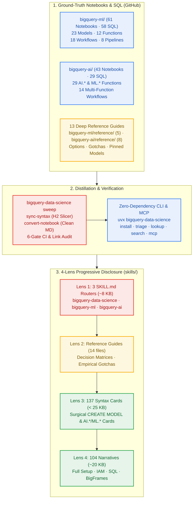

# bigquery-data-science

**Production Agent Skills, zero-dependency CLI & stdio MCP server for BigQuery ML and BigQuery AI — distilled directly from 104 live-executed notebooks and 87 SQL scripts in Google Cloud.**

[](https://pypi.org/project/bigquery-data-science/)
[](bigquery-ml/README.md)
[](bigquery-ai/README.md)
[](skills/PLANS.md)
[](skills/bigquery-data-science/reference/namespace-matrix.md)
[](LICENSE)

`104 live-verified notebooks` · `87 SQL scripts` · `3 Agent Skills` · `137 <25 KB syntax cards` · `zero-dependency CLI & stdio MCP`



---

## What you just found

This repository pairs **two complementary layers** that stay synchronized through automated tooling (`bigquery-data-science sweep`):

1. **Ground-Truth Notebooks, SQL & Reference Guides ([`bigquery-ml/`](bigquery-ml/README.md) & [`bigquery-ai/`](bigquery-ai/README.md)):** Every model type, `ML.*` function, `AI.*` function, composed workflow, and orchestration pipeline is validated end-to-end in a live-executed Jupyter notebook (`.ipynb` with stored execution outputs and one-click Colab / Vertex AI Workbench / BigQuery Studio headers) paired with a pure SQL companion script (`.sql`) and 13 exhaustive domain reference guides.
2. **4-Lens Agent Skills, CLI & Stdio MCP Server ([`skills/`](skills/PLANS.md) & [`src/bigquery_data_science/`](src/bigquery_data_science/__init__.py)):** Instead of dumping 24 MB of raw notebooks or 200+ KB monolithic reference files into an AI coding agent's context window, `bigquery-data-science` compiles the ground-truth notebooks and references into **4 progressive lenses** — routing agents from an `~8 KB` `SKILL.md` decision tree to a surgical `<25 KB` syntax card (`syntax/*.md`) or a clean markdown walkthrough (`narrative/*.md`) only when needed.

---

## Three ways to start

### Journey 1 — Equip your AI coding agent (`uvx`, `uv`, `pip`, `pipx`, `npx skills`, or MCP)

The core `bigquery-data-science` package has **zero third-party runtime dependencies** (`< 1.5 MB` wheel) and installs the 3 skills (`bigquery-data-science`, `bigquery-ml`, `bigquery-ai`) into `.agents/skills/` and `.claude/skills/`:

```bash
# Option A — Zero-install ephemeral CLI via uvx (recommended for instant setup):
uvx bigquery-data-science install                     # installs into ./.agents/skills & ./.claude/skills
uvx bigquery-data-science install --mcp               # also registers stdio MCP server in ./.mcp.json
uvx bigquery-data-science install --global            # installs into ~/.agents/skills & ~/.claude/skills
uvx bigquery-data-science install --target agents     # only .agents/skills (Antigravity, Cursor, Codex, Windsurf)
uvx bigquery-data-science install --target claude     # only .claude/skills (Claude Code)

# Option B — Persistent CLI install via uv tool, pipx, or pip:
uv tool install bigquery-data-science && bigquery-data-science install
pipx install bigquery-data-science && bigquery-data-science install
pip install bigquery-data-science && bigquery-data-science install

# Option C — Add to an existing Python project (uv or pip):
uv add bigquery-data-science && uv run bigquery-data-science install
pip install bigquery-data-science && python3 -m bigquery_data_science.cli install

# Option D — skills.sh CLI (installs all 3 skills or an individual skill from GitHub):
npx skills add statmike/bigquery-data-science
npx skills add statmike/bigquery-data-science --skill bigquery-ml

# Option E — Claude Code plugin marketplace & stdio MCP server:
# In Claude Code: /plugin marketplace add statmike/bigquery-data-science
#                 /plugin install bigquery-data-science
claude mcp add bigquery-data-science -- uvx bigquery-data-science mcp
# Or with a local pip/uv install:
claude mcp add bigquery-data-science -- python3 -m bigquery_data_science.cli mcp
```

### Journey 2 — Triage tasks & look up exact BigQuery syntax from the terminal

Run any catalog command directly with `uvx bigquery-data-science ...` (zero install) or `bigquery-data-science ...` (after `uv tool install` or `pip install`):

```bash
# 1. List bundled skills and lens counts:
uvx bigquery-data-science list

# 2. Triage an ambiguous BigQuery ML vs BigQuery AI task (10 empirical head-to-head comparisons):
uvx bigquery-data-science triage "forecast daily retail sales with holiday promotions"

# 3. Fetch the surgical syntax card (< 25 KB) for any model or function:
uvx bigquery-data-science lookup ARIMA_PLUS
uvx bigquery-data-science lookup AI.FORECAST
uvx bigquery-data-science lookup ML.ENTITY_FEATURES_AT_TIME

# 4. Search across all 137 syntax cards, 14 reference guides, and 104 narratives:
uvx bigquery-data-science search "point-in-time feature leakage"

# 5. Statically audit a BigQuery SQL query or .sql file for prerequisites & gotchas:
uvx bigquery-data-science review-sql "SELECT AI.GENERATE('Summarize', endpoint => 'gemini-3.5-flash')"

# 6. Add --json to any catalog command (list, lookup, search, triage, review-sql) for automation:
uvx bigquery-data-science lookup AI.AGG --json
```

### Journey 3 — Run the 104 ground-truth notebooks & SQL scripts (`uv` or `pip`)

Every notebook in [`bigquery-ml/`](bigquery-ml/README.md) and [`bigquery-ai/`](bigquery-ai/README.md) includes committed outputs for immediate reading on GitHub and one-click launch links for **Colab**, **Colab Enterprise**, **Vertex AI Workbench**, and **BigQuery Studio**.

To run notebooks locally, choose the dependency extra that matches the folders you want to execute:

| Extra | Scope | With `uv` (from a repository clone) | With `uv pip` or standard `pip` |
| :--- | :--- | :--- | :--- |
| **`(none)`** | Skills, CLI (`install`, `triage`, `lookup`, `search`), and stdio MCP server (`0` third-party dependencies) | `uv sync --no-dev` | `pip install bigquery-data-science` |
| **`[notebooks]`** | Core runtime for all 104 notebooks (`google-cloud-bigquery`, `bigframes`, `bigquery-magics`, `matplotlib`, `ipykernel`, `weasyprint`) | `uv sync --extra notebooks` | `pip install "bigquery-data-science[notebooks]"` |
| **`[workflows]`** | Adds causal inference, survival analysis, and ONNX/XGBoost import/export (`scikit-learn`, `scipy`, `xgboost`, `lifelines`, `differences`, `onnxruntime`) | `uv sync --extra workflows` | `pip install "bigquery-data-science[workflows]"` |
| **`[pipelines]`** | Adds GCP orchestration SDKs for `bigquery-ml/pipelines/*` (`kfp`, `google-cloud-aiplatform`, `dataform`, `workflows`, `orchestration-airflow`) | `uv sync --extra pipelines` | `pip install "bigquery-data-science[pipelines]"` |
| **`[all]`** | Complete notebook, workflow, and pipeline suite | `uv sync --extra all` | `pip install "bigquery-data-science[all]"` |

```bash
git clone https://github.com/statmike/bigquery-data-science.git
cd bigquery-data-science

# With uv (recommended — uses the locked uv.lock environment):
uv sync --extra all
uv run bigquery-data-science kernel --user

# Or with standard Python venv + pip:
python3 -m venv .venv && source .venv/bin/activate
pip install -e ".[all]"
bigquery-data-science kernel --user
```

---

## Front Door 1 — Agent Skills & 4-Lens Progressive Disclosure ([`skills/`](skills/PLANS.md))

### The 3 Bundled Skills

| Skill | Canonical Role | What It Covers | Entry Point |
| :--- | :--- | :--- | :--- |
| **[`bigquery-data-science`](skills/bigquery-data-science/SKILL.md)** | **Umbrella Router & Namespace Decoder** (`Workflow` + `Reviewer`) | Routes between trained `CREATE MODEL` (`bigquery-ml`), zero-shot `AI.*`/`ML.*` (`bigquery-ai`), and hybrid pipelines; 10 empirical head-to-head task comparisons; complete `ML.*` vs `AI.*` prerequisite matrix ([`namespace-matrix.md`](skills/bigquery-data-science/reference/namespace-matrix.md)). | [`skills/bigquery-data-science/SKILL.md`](skills/bigquery-data-science/SKILL.md) |
| **[`bigquery-ml`](skills/bigquery-ml/SKILL.md)** | **Trained Models, Preprocessing & Pipelines** (`Workflow` + `Generator` + `Tool Wrapper` + `Reviewer`) | 23 `CREATE MODEL` types (`LINEAR_REG`, `BOOSTED_TREE_*`, `ARIMA_PLUS`, `ARIMA_PLUS_XREG`, `KMEANS`, `PCA`, `MATRIX_FACTORIZATION`, `DNN_*`, `AUTOML_*`, `CONTRIBUTION_ANALYSIS`, imported `ONNX`/`TENSORFLOW`/`XGBOOST`), 20+ model-free `ML.*` preprocessing/drift/feature-time functions, 18 workflows, and 8 production orchestration patterns. | [`skills/bigquery-ml/SKILL.md`](skills/bigquery-ml/SKILL.md) |
| **[`bigquery-ai`](skills/bigquery-ai/SKILL.md)** | **Foundation Models, Embeddings, Search & Document AI** (`Workflow` + `Generator` + `Tool Wrapper` + `Reviewer`) | 29 SQL functions across `AI.GENERATE*`, `AI.IF`/`SCORE`/`CLASSIFY`/`AGG`, `AI.EMBED` + `VECTOR_SEARCH` + `AI.SEARCH`, `AI.FORECAST` + `AI.DETECT_ANOMALIES` (TimesFM), `AI.PREDICT` + `AI.EVALUATE` (TabFM), `AI.KEY_DRIVERS`, `AI.PARSE_DOCUMENT` + `ML.PROCESS_DOCUMENT`, and Cloud AI `ML.TRANSLATE`/`UNDERSTAND_TEXT`/`ANNOTATE_IMAGE`/`TRANSCRIBE`, plus 14 multi-function workflows. | [`skills/bigquery-ai/SKILL.md`](skills/bigquery-ai/SKILL.md) |

### How the 4 Progressive Lenses Prevent Context Bloat

| Lens | Skill Path | Typical Size | When the Agent Loads It |
| :--- | :--- | :--- | :--- |
| **Lens 1 — Router & Guardrails** | `skills/*/SKILL.md` | `~6–9 KB` | **Always first.** Task routing tree, critical SQL generation rules, cross-cutting empirical gotchas, and pre-delivery verification checklist. |
| **Lens 2 — Decision & Gotcha Guide** | `skills/*/reference/*.md` | `~15–45 KB` | **When comparing options within a family** (e.g., choosing among forecasting models, orchestration engines, or `AI.IF` vs `AI.CLASSIFY` vs `AI.GENERATE_TABLE`). |
| **Lens 3 — Surgical Syntax Card** | `skills/*/syntax/*.md` ([`ML Index`](skills/bigquery-ml/syntax/INDEX.md) · [`AI Index`](skills/bigquery-ai/syntax/INDEX.md)) | `4–15 KB` (`< 25 KB` enforced) | **When writing SQL for a specific model or function.** Sliced automatically by H2 (`## `) from `reference/*.md` so agents never load a 218 KB monolith. |
| **Lens 4 — Worked Textbook Narrative** | `skills/*/narrative/*.md` (`104` files) | `~15–30 KB` | **Only when building a full end-to-end pipeline** (including GCP IAM, Cloud Resource Connections, reservations, and multi-step SQL / BigFrames choreography). Never loads raw `.ipynb` JSON. |

---

## Front Door 2 — Ground-Truth Notebooks, SQL & Reference Hubs ([`bigquery-ml/`](bigquery-ml/README.md) & [`bigquery-ai/`](bigquery-ai/README.md))

### Decoding BigQuery's `ML.*` vs `AI.*` SQL Namespaces

BigQuery exposes machine learning and generative AI across two SQL prefixes (`ML.*` and `AI.*`) that reflect **when** a function was introduced and **whether** it requires a `CREATE MODEL` DDL object. Full matrix: **[`skills/bigquery-data-science/reference/namespace-matrix.md`](skills/bigquery-data-science/reference/namespace-matrix.md)**.

| Pattern | SQL Prefix | Requires `CREATE MODEL`? | Requires Cloud Resource Connection? | Representative Examples | Primary Hub |
| :--- | :--- | :--- | :--- | :--- | :--- |
| **1. Customer-Trained Models & Lifecycle** | `CREATE MODEL` + `ML.*` | **Yes** (trained on your table) | Only for `MATRIX_FACTORIZATION` / `AUTOML_*` / `REMOTE` | `LINEAR_REG`, `BOOSTED_TREE_*`, `ARIMA_PLUS`, `KMEANS`, `PCA`, `ML.PREDICT`, `ML.EVALUATE`, `ML.EXPLAIN_PREDICT`, `ML.FORECAST`, `ML.GET_INSIGHTS` | **[`bigquery-ml/`](bigquery-ml/README.md)** |
| **2. Model-Free Feature Engineering, Drift & Point-in-Time Joins** | `ML.*` | **No** (operates directly on tables/queries) | No | `ML.STANDARD_SCALER`, `ML.QUANTILE_BUCKETIZE`, `ML.ONE_HOT_ENCODER`, `ML.VALIDATE_DATA_DRIFT`, `ML.TF_IDF`, `ML.NGRAMS`, `ML.ENTITY_FEATURES_AT_TIME` | **[`bigquery-ml/`](bigquery-ml/README.md)** |
| **3. Zero-Training Foundation Model Functions (Gemini, TimesFM, TabFM)** | `AI.*` (plus `VECTOR_SEARCH`) | **No** (`endpoint => '...'` inline or managed) | For multimodal `ObjectRef` or custom connections | `AI.GENERATE`, `AI.GENERATE_TABLE`, `AI.IF`, `AI.SCORE`, `AI.CLASSIFY`, `AI.AGG`, `AI.EMBED`, `AI.SEARCH`, `AI.FORECAST`, `AI.DETECT_ANOMALIES`, `AI.PREDICT`, `AI.EVALUATE`, `AI.KEY_DRIVERS`, `AI.PARSE_DOCUMENT` | **[`bigquery-ai/`](bigquery-ai/README.md)** |
| **4. Remote Cloud AI APIs & First-Gen Vertex Wrappers** | `CREATE MODEL ... REMOTE` + `ML.*` | **Yes** (thin metadata pointer to Vertex / Cloud AI API) | **Yes** (`CLOUD_RESOURCE` connection + IAM) | `ML.PROCESS_DOCUMENT`, `ML.TRANSLATE`, `ML.UNDERSTAND_TEXT`, `ML.ANNOTATE_IMAGE`, `ML.TRANSCRIBE`, `ML.GENERATE_TEXT`, `ML.GENERATE_EMBEDDING` | **[`bigquery-ai/`](bigquery-ai/README.md)** |

### Navigate the Notebook & Reference Hubs

Instead of scrolling through 104 individual rows here, jump directly into the domain hubs and category indexes below:

| Domain Hub | Sub-Folder / Resource | Count | What You Will Find Inside | Direct Entry Points |
| :--- | :--- | :--- | :--- | :--- |
| **[BigQuery ML (`bigquery-ml/`)](bigquery-ml/README.md)**<br/>*Trained `CREATE MODEL` + model-free `ML.*` + MLOps* | **Start Here & Reference Index** | `1` overview + `5` guides | Interactive tour of all BigQuery ML capabilities, environment setup, and the complete [`RESOURCES.md`](bigquery-ml/RESOURCES.md) reference map. | [`bigquery-ml/README.md`](bigquery-ml/README.md) · [`overview.ipynb`](bigquery-ml/overview.ipynb) · [`RESOURCES.md`](bigquery-ml/RESOURCES.md) · [`setup/`](bigquery-ml/setup/README.md) |
| | **[`bigquery-ml/models/`](bigquery-ml/models/)** | `23` folders (`23` `.ipynb`, `23` `.sql`) | Every `CREATE MODEL` type: `linear_reg`, `logistic_reg`, `boosted_tree_*`, `random_forest_*`, `dnn_*`, `wide_and_deep_*`, `automl_*`, `arima_plus`, `arima_plus_xreg`, `kmeans`, `pca`, `autoencoder`, `matrix_factorization`, `contribution_analysis`, `cox_proportional_hazards`, and imported `onnx`/`tensorflow`/`xgboost`. | [`bigquery-ml/README.md` (Model Catalog)](bigquery-ml/README.md) · [`reference/create-model-model-types.md`](bigquery-ml/reference/create-model-model-types.md) · [`reference/comparison-tables.md`](bigquery-ml/reference/comparison-tables.md) |
| | **[`bigquery-ml/functions/`](bigquery-ml/functions/)** | `12` folders (`12` `.ipynb`, `12` `.sql`) | `ML.EVALUATE`, `ML.PREDICT`, `ML.EXPLAIN_PREDICT`, `ML.GLOBAL_EXPLAIN`, `ML.FEATURE_INFO`, `ML.TRANSFORM`, numerical/categorical/text preprocessing, `ML.VALIDATE_DATA_DRIFT`, `ML.DESCRIBE_DATA`, `ML.ENTITY_FEATURES_AT_TIME`, `ML.FEATURES_AT_TIME`, and hyperparameter tuning. | [`bigquery-ml/README.md` (Function Catalog)](bigquery-ml/README.md) · [`reference/model-lifecycle-functions.md`](bigquery-ml/reference/model-lifecycle-functions.md) · [`reference/model-free-functions.md`](bigquery-ml/reference/model-free-functions.md) · [`reference/model-management-monitoring.md`](bigquery-ml/reference/model-management-monitoring.md) |
| | **[`bigquery-ml/workflows/`](bigquery-ml/workflows/)** | `18` folders (`18` `.ipynb`, `15` `.sql`) | End-to-end applied ML workflows: customer LTV, churn & survival analysis, demand forecasting at scale, fraud detection, propensity scoring, price elasticity, A/B uplift & causal inference, recommendation systems, anomaly detection, and model monitoring. | [`bigquery-ml/README.md` (Workflows)](bigquery-ml/README.md) · [`skills/bigquery-ml/reference/workflows-and-pipelines.md`](skills/bigquery-ml/reference/workflows-and-pipelines.md) |
| | **[`bigquery-ml/pipelines/`](bigquery-ml/pipelines/)** | `8` folders (`8` `.ipynb`, `8` `.sql`) | Production MLOps orchestration: Scheduled Queries, Dataform SQLX, Google Cloud Workflows, Cloud Composer (Airflow), Vertex AI Pipelines (KFP), Vertex AI Model Registry & online endpoints, and Vertex AI Feature Store. | [`bigquery-ml/README.md` (Pipelines)](bigquery-ml/README.md) · [`skills/bigquery-ml/reference/workflows-and-pipelines.md`](skills/bigquery-ml/reference/workflows-and-pipelines.md) |
| **[BigQuery AI (`bigquery-ai/`)](bigquery-ai/README.md)**<br/>*Zero-training `AI.*` foundation models + Cloud AI `ML.*`* | **Start Here & Reference Index** | `2` setup/overview + `8` guides | Interactive tour of BigQuery AI functions, synthetic multimodal/PDF dataset generator ([`data/documents/generate.ipynb`](bigquery-ai/data/documents/generate.ipynb)), and [`RESOURCES.md`](bigquery-ai/RESOURCES.md). | [`bigquery-ai/README.md`](bigquery-ai/README.md) · [`overview.ipynb`](bigquery-ai/overview.ipynb) · [`RESOURCES.md`](bigquery-ai/RESOURCES.md) · [`setup/`](bigquery-ai/setup/README.md) |
| | **[`bigquery-ai/functions/`](bigquery-ai/functions/)** | `29` folders (`29` `.ipynb`, `29` `.sql`) | General-purpose generation (`AI.GENERATE*`, `AI.COUNT_TOKENS`), managed task functions (`AI.IF`, `AI.SCORE`, `AI.CLASSIFY`, `AI.AGG`), embeddings & vector search (`AI.EMBED`, `AI.SIMILARITY`, `VECTOR_SEARCH`, `AI.SEARCH`), Predictive AI (`AI.FORECAST`, `AI.DETECT_ANOMALIES`, `AI.PREDICT`, `AI.EVALUATE`), `AI.KEY_DRIVERS`, Document AI (`AI.PARSE_DOCUMENT`, `ML.PROCESS_DOCUMENT`), and Cloud AI (`ML.TRANSLATE`, `ML.UNDERSTAND_TEXT`, `ML.ANNOTATE_IMAGE`, `ML.TRANSCRIBE`). | [`bigquery-ai/README.md` (Function Catalog)](bigquery-ai/README.md) · [`reference/general-purpose-functions.md`](bigquery-ai/reference/general-purpose-functions.md) · [`reference/managed-functions.md`](bigquery-ai/reference/managed-functions.md) · [`reference/embedding-generation-and-semantic-search.md`](bigquery-ai/reference/embedding-generation-and-semantic-search.md) · [`reference/predictive-ai.md`](bigquery-ai/reference/predictive-ai.md) · [`reference/document-processing.md`](bigquery-ai/reference/document-processing.md) |
| | **[`bigquery-ai/workflows/`](bigquery-ai/workflows/)** | `14` folders (`14` `.ipynb`) | Composed multi-function pipelines: semantic search, RAG, hybrid catalog search (BM25 + vector + RRF + `AI.SCORE`), content analysis & moderation, data enrichment, zero-shot vs trained tabular prediction, time-series intelligence, metric diagnostics, log analysis, document intelligence & PDF RAG, multimodal analysis, and image deduplication. | [`bigquery-ai/README.md` (Workflows)](bigquery-ai/README.md) · [`reference/unstructured-data-infrastructure.md`](bigquery-ai/reference/unstructured-data-infrastructure.md) · [`reference/cloud-ai-service-models.md`](bigquery-ai/reference/cloud-ai-service-models.md) · [`reference/augmented-analytics.md`](bigquery-ai/reference/augmented-analytics.md) |

---

## Contributing, Pre-Commit & CI/CD

Contributions are welcome — see [`CONTRIBUTING.md`](CONTRIBUTING.md), [`CODE_OF_CONDUCT.md`](CODE_OF_CONDUCT.md), and [`SECURITY.md`](SECURITY.md).

- **GitHub Actions CI & Release Workflows:** [`.github/workflows/ci.yml`](.github/workflows/ci.yml) runs `ruff`, `mypy`, `pytest`, `bigquery-data-science sweep`, `sync_headers.py --check`, and `./scripts/check_install.sh` across Python 3.11, 3.12, and 3.13 on every push and pull request. [`.github/workflows/release.yml`](.github/workflows/release.yml) publishes release candidates (`v*rc*`) to TestPyPI and production tags (`v*`) to PyPI via OIDC Trusted Publishing.
- **Local Pre-Commit Hooks ([`.pre-commit-config.yaml`](.pre-commit-config.yaml)):** Install with `uv run pre-commit install` to run `ruff`, `mypy`, `bigquery-data-science sweep`, and `sync_headers.py --check` automatically before each commit.

Run the complete local verification and cold-install gate before submitting a pull request:

```bash
uv run ruff check src tests && \
  uv run mypy src && \
  uv run pytest -q && \
  uv run bigquery-data-science sweep && \
  python3 architectures/headers/sync_headers.py --check && \
  ./scripts/check_install.sh
```

## Versioning & Release Cadence

`bigquery-data-science` adheres to [Semantic Versioning](https://semver.org/spec/v2.0.0.html) (`Major.Minor.Patch`):

- **Major (`X.0.0`) — Skills architecture, names & structural contract shifts:** Changes in skills hierarchy/naming (`skills/`), packaging overhauls, or breaking changes to CLI subcommands, MCP tool schemas, or library exports.
- **Minor (`X.Y.0`) — Multi-area monthly sweeps & capability rollouts:** Scheduled monthly sweeps across BigQuery release notes — introducing new foundation models, options, notebooks, SQL workflows, and synchronized 4-lens skill updates.
- **Patch (`X.Y.Z`) — Targeted single-area updates & fixes:** Isolated bug fixes, typo corrections, single-notebook adjustments, or targeted hotfixes.

See [`CONTRIBUTING.md`](CONTRIBUTING.md#releasing) for the full release process and TestPyPI/PyPI tag flow.

## License

Apache-2.0 — see [`LICENSE`](LICENSE).

This is not an officially supported Google product. It is built on Google products and is neither
endorsed nor supported by Google.
