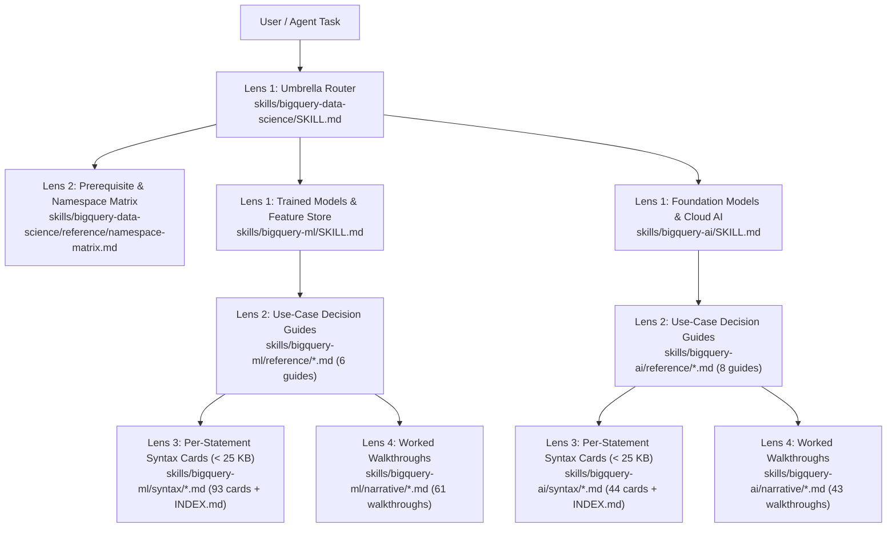

# Agent Skills — Operating Manual & 4-Lens Architecture (`skills/PLANS.md`)

Operating manual for the `bigquery-data-science` Agent Skills bundle: the 4-Lens progressive context-loading architecture, the authoring standard, the change checklists, and the verification audit log. Mirrors the `README.md` + `PLANS.md` + `RESOURCES.md` convention used in `bigquery-ml` and `bigquery-ai`.

## Vision & 4-Lens Progressive Architecture

Package this repository's live-verified BigQuery ML (`bigquery-ml`) and BigQuery AI (`bigquery-ai`) content as zero-dependency Agent Skills usable across Claude Code, Gemini CLI, Cursor, Windsurf, OpenAI Codex, and any MCP client.

To prevent context-window bloat while keeping 100% of syntax tables, empirical gotchas, and end-to-end walkthroughs reachable offline, every skill in `skills/` follows a **4-Lens progressive disclosure hierarchy**:

- **Lens 1 (`SKILL.md`, < 500 lines)**: High-signal entry router, decision tree, 5 Canonical Skill Patterns (Router, Tool Wrapper, Generator, Reviewer, Inversion), and cross-cutting gotchas.
- **Lens 2 (`reference/<bucket>.md`)**: Use-case decision guides (or the cross-domain prerequisite matrix `reference/namespace-matrix.md` in `bigquery-data-science`) with comparison tables, verified empirical gotchas, canonical SQL/BigFrames snippets, and links into Lens 3 and Lens 4. Files exceeding 100 lines open with a `Contents:` table of contents in the first 10 lines.
- **Lens 3 (`syntax/<slug>.md` + `syntax/INDEX.md`, each card < 25 KB)**: Deterministic, per-statement syntax and option cards auto-sliced at `## ` (H2) boundaries from `bigquery-ml/reference/*.md` (93 cards) and `bigquery-ai/reference/*.md` (44 cards) via `bigquery-data-science sync-syntax`. Every card carries a clickable GitHub `Source:` blockquote linking back to its exact heading in the domain reference page.
- **Lens 4 (`narrative/<topic>.md`, 104 walkthroughs)**: Complete, ceremony-stripped markdown walkthroughs extracted from all 61 `bigquery-ml` topic notebooks and 43 `bigquery-ai` topic notebooks via `bigquery-data-science convert-notebook`. Every narrative starts with a clickable GitHub provenance banner linking to the source `.ipynb` and companion `.sql` script.



## Authoring Standard

A skill is a directory under `skills/<name>/` (symlinked into `.agents/skills/<name>` and `.claude/skills/<name>`):

1. **`SKILL.md` (Lens 1)** — YAML frontmatter (`name` <= 64 chars lowercase/digits/hyphens; `description` <= 1024 chars; `metadata.version: "<version>"`) + decision tree + Tool Wrapper & Generator patterns + Reviewer checklist + cross-cutting gotchas + pointers to `reference/*.md` and `syntax/INDEX.md`. Strictly < 500 lines.
2. **`reference/<bucket>.md` (Lens 2)** — One file per use-case bucket, organized by what the practitioner is trying to accomplish. Each carries a single H1 heading, a `Contents:` TOC in the first 10 lines when > 100 lines, an options table, selection guidance, verified empirical gotchas, a canonical snippet, and relative links into `../syntax/<slug>.md` and `../narrative/<topic>.md`.
3. **`syntax/<slug>.md` + `syntax/INDEX.md` (Lens 3)** — Auto-generated from `<domain>/reference/*.md` via `uv run bigquery-data-science sync-syntax`. Never hand-edit `syntax/*.md`; edit the source `<domain>/reference/*.md` page and re-run `sync-syntax`. Every card is verified `< 25,000` bytes.
4. **`narrative/<topic>.md` (Lens 4)** — Auto-generated from `<domain>/{models,functions,workflows,pipelines}/**/*.ipynb` via `uv run bigquery-data-science sync-narratives` (or `convert-notebook`). Strips the HTML tracker header, `def install(*packages):` helper, Colab auth shim, and trailing `## Cleanup` section while prepending a clickable GitHub provenance banner to the source `.ipynb` and `.sql`.
5. **`skill.manifest.json`** — Generated via `uv run bigquery-data-science manifest --all --version <version>`.

## Change Types and Checklists

### Semantic Versioning Strategy & Sweep Cadence

This repository, the Python package, and all three agent skills follow a coordinated SemVer structure (`Major.Minor.Patch`):

- **Major (`X.0.0`) — Skills architecture, names & structural contract shifts:**
  - Changes in skills layout, naming, or hierarchy (`skills/`), packaging changes, or removing/incompatibly changing CLI subcommands, MCP tool schemas, or Python library public exports.
- **Minor (`X.Y.0`) — Multi-area monthly sweeps & capability rollouts:**
  - Multi-area updates spanning monthly upstream sweeps: adding new notebooks, workflows, foundation models, options, and synchronized 4-lens skill updates.
- **Patch (`X.Y.Z`) — Targeted single-area updates & fixes:**
  - Targeted single-area updates, isolated bug fixes, typo fixes, or individual notebook adjustments.

When bumping versions across the repository:
1. Update all single-sourced version locations: `pyproject.toml`, `src/bigquery_data_science/__init__.py`, `tests/test_packaging.py`, `plugin.json`, `.claude-plugin/marketplace.json`, `CITATION.cff`, and `CHANGELOG.md`.
2. Update `metadata.version` in `skills/{bigquery-data-science,bigquery-ml,bigquery-ai}/SKILL.md`.
3. Run `uv run bigquery-data-science manifest --all --version X.Y.Z` to refresh all `skill.manifest.json` files and hashes.
4. Re-lock dependencies with `UV_NO_CONFIG=1 uv lock`.

#### Adding or updating a model, function, or workflow
- [ ] Update the ground-truth notebook/SQL and `<domain>/reference/*.md` in `bigquery-ml/` or `bigquery-ai/`.
- [ ] Update the corresponding Lens 2 decision guide in `skills/<domain>/reference/<bucket>.md` (and `skills/bigquery-data-science/reference/namespace-matrix.md` if adding a new symbol).
- [ ] Run `uv run bigquery-data-science sync-syntax` to regenerate Lens 3 syntax cards and `syntax/INDEX.md`.
- [ ] Run `uv run bigquery-data-science sync-narratives` to regenerate Lens 4 narrative markdown files.
- [ ] Run `uv run bigquery-data-science manifest --all --version <version>` to refresh `skill.manifest.json`.
- [ ] Run `uv run bigquery-data-science sweep` and confirm all 6 verification stages exit `0`.

#### Adopting or retiring a pinned model version
- [ ] Update `skills/pinned-models.json` (`*`, `bigquery-ml`, `bigquery-ai`).
- [ ] Run `uv run bigquery-data-science check-pinned-models bigquery-ml` and `uv run bigquery-data-science check-pinned-models bigquery-ai`.

#### Maintainer tooling change (`src/bigquery_data_science/`)
- [ ] Update the module under `src/bigquery_data_science/`.
- [ ] Prove every new check fails on a broken fixture in `tests/` before trusting a green pass.
- [ ] Run the full verification gate:
  ```bash
  uv run ruff check src tests
  uv run mypy src
  uv run pytest -q
  uv run bigquery-data-science sweep
  python3 architectures/headers/sync_headers.py --check
  ./scripts/check_install.sh
  ```

## Audit Log

- **2026-07-29** — Phase 1 kickoff: built notebook-to-narrative extraction (`convert_notebook.py`), skill validator (`validate.py`), and manifest generator (`manifest.py`).
- **2026-09-04** — Added `check-reference` (1:1 `RESOURCES.md` <-> `reference/*.md` coverage and heading-depth enforcement), `check-narratives` (regenerate-and-diff against `source_project` notebooks), and GitHub-verified `#anchor` resolution in `check-links` via `markdown_anchors.py`.
- **2026-09-11** — Added point-in-time feature retrieval (`ML.FEATURES_AT_TIME`, `ML.ENTITY_FEATURES_AT_TIME`), `narrative_sources` collision disambiguation (`feature_store.md` vs `feature_store_workflow.md`), SQL image preprocessing (`ML.DECODE_IMAGE`, `ML.RESIZE_IMAGE`, `ML.CONVERT_COLOR_SPACE`, `ML.CONVERT_IMAGE_TYPE`), and the 5 pre-trained Cloud AI service models (`ML.PROCESS_DOCUMENT`, `ML.TRANSLATE`, `ML.UNDERSTAND_TEXT`, `ML.ANNOTATE_IMAGE`, `ML.TRANSCRIBE`).
- **2026-10-09** — Added `check-pinned-models` (`skills/pinned-models.json`), lazy `nbformat` imports so CLI and MCP commands run with zero third-party dependencies, and the single-command `sweep` gate.
- **2026-10-19** — Consolidated standalone `statmike/bigquery-data-science` v0.7.0 release: unified 1:1 naming (`bigquery-data-science`, `bigquery-ml`, `bigquery-ai`), added `skills/bigquery-data-science/reference/namespace-matrix.md`, added Lens 3 H2-sliced syntax cards (`sync-syntax`, 93 cards in `bigquery-ml/syntax/` and 44 cards in `bigquery-ai/syntax/`, all < 25 KB), expanded Lens 4 to all 104 topic notebooks (`61` in `bigquery-ml/narrative/` + `43` in `bigquery-ai/narrative/`) with clickable GitHub `.ipynb`/`.sql` provenance banners, and shipped the zero-dependency CLI (`list`, `path`, `install`, `kernel`, `lookup`, `search`, `triage`, `sweep`) and stdio MCP server (`triage_bigquery_task`, `lookup_bigquery_syntax`, `search_bigquery_gotchas`, `get_bigquery_walkthrough`).
