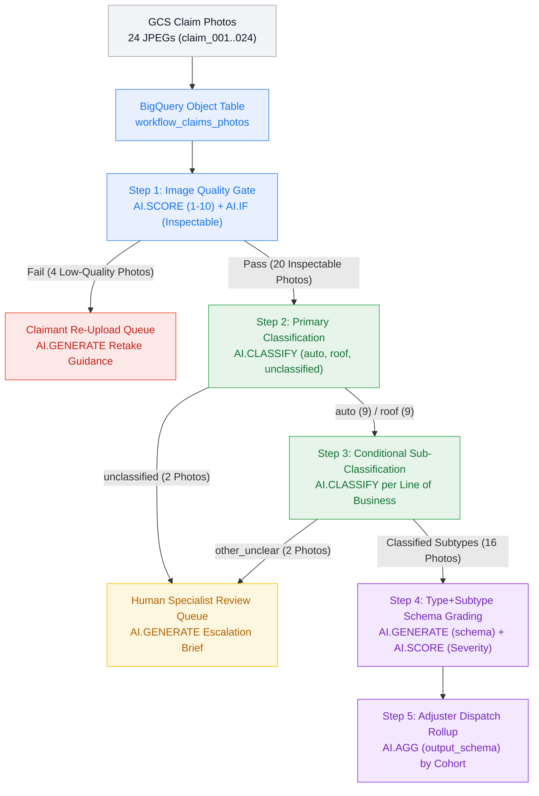

> **Source (`statmike/bigquery-data-science`):** **Notebook:** [`bigquery-ai/workflows/claims_adjustment/claims_adjustment.ipynb`](https://github.com/statmike/bigquery-data-science/blob/main/bigquery-ai/workflows/claims_adjustment/claims_adjustment.ipynb)

# Insurance Claims Adjustment — BigQuery AI Functions

An end-to-end multimodal Property & Casualty (P&C) insurance claims triage and adjustment pipeline that composes **five BigQuery AI functions** over 24 First-Notice-of-Loss (FNOL) claim photos in Cloud Storage:

1. **Gate intake photo quality** (`AI.SCORE` + `AI.IF`) and generate retake guidance (`AI.GENERATE`) for uninspectable uploads
2. **Classify primary line of business** (`AI.CLASSIFY` with `STRUCT<category, description>`) into `'auto'`, `'roof'`, or `'unclassified'`
3. **Sub-classify domain perils** (`AI.CLASSIFY` branched by line of business) and route out-of-scope or ambiguous claims to **Human Specialist Review** (`AI.GENERATE`)
4. **Grade type+subtype damage schemas & severity** (`AI.GENERATE` with `output_schema` + `AI.SCORE`) for Auto and Roof claims
5. **Synthesize cohort adjuster dispatch plans** (`AI.AGG` with `output_schema`) across all `(claim_type, claim_subtype)` cohorts

**What this demonstrates:**
- **Stopping garbage-in hallucinations before extraction**: Mobile claim uploads frequently include motion blur, pitch-dark night photos, extreme macro defocus, or accidental non-asset shots (paperwork/fingers over the lens). Gating with `AI.SCORE` + `AI.IF` diverts defective uploads to a **Claimant Re-Upload Queue** before downstream classification or schema extraction runs.
- **Hierarchical classification with explicit catch-all routing**: Using `STRUCT(category, description)` in `AI.CLASSIFY` separates standard `'auto'` and `'roof'` claims from out-of-scope property perils at Step 2 (`'unclassified'`) and separates standard auto/roof sub-perils from unusual edge cases at Step 3 (`'other_unclear'`).
- **Line-of-business schema specialization**: Auto claims extract vehicle-specific fields (`affected_component`, `drivable_status`, `structural_or_safety_risk`, `recommended_repair_method`), whereas Roof claims extract property-specific fields (`roof_material`, `deck_or_underlayment_exposed`, `active_water_intrusion_risk`, `emergency_tarp_required`, `recommended_repair_scope`).
- **Validating multi-stage AI decisions against ground truth**: Joining Step 1, Step 2, and Step 3 outputs against `data/claims/manifest.json` verifies `24/24` (`100%`) quality gating, classification, sub-classification, and queue routing accuracy.



| Stage | BigQuery AI Function(s) | Operational Role | Cohort Count |
|---|---|---|---|
| **Step 1 — Intake Quality Gate** | `AI.SCORE` + `AI.IF` + `AI.GENERATE` | Score photo clarity (`1–10`) and verify an inspectable asset is visible; divert defective uploads to the **Claimant Re-Upload Queue** with automated retake instructions | `24` evaluated $\to$ `4` stopped (`20` pass) |
| **Step 2 — Primary Classification** | `AI.CLASSIFY` (`STRUCT` descriptions) | Classify inspectable photos into `'auto'`, `'roof'`, or `'unclassified'`; divert out-of-scope claims to **Human Specialist Review** | `20` evaluated $\to$ `2` routed to human (`9` auto, `9` roof) |
| **Step 3 — Conditional Sub-Classification** | `AI.CLASSIFY` (branched SQL) + `AI.GENERATE` | Sub-classify Auto (`collision_panel`, `glass_windshield`, `hail_dents`, `other_unclear`) and Roof (`wind_missing_shingles`, `hail_impact`, `tree_structural_impact`, `other_unclear`); divert `'other_unclear'` to **Human Specialist Review** | `18` evaluated $\to$ `2` routed to human (`16` auto-graded) |
| **Step 4 — Type+Subtype Schema Grading** | `AI.GENERATE` (`output_schema`) + `AI.SCORE` | Extract line-of-business damage attributes and score severity (`1–10`) to assign SLA dispatch tiers (`Fast-Track Auto-Approve`, `Standard Adjuster Review`, `Urgent Field Inspector`) | `8` Auto + `8` Roof (`16` graded) |
| **Step 5 — Adjuster Dispatch Rollup** | `AI.AGG` (`output_schema`) | Synthesize cohort-level adjuster dispatch plans and dominant damage patterns across all 6 `(claim_type, claim_subtype)` groups | `6` subtype cohorts summarized |

**Functions used:** `functions/ai_if` (`AI.IF`) | `functions/ai_score` (`AI.SCORE`) | `functions/ai_classify` (`AI.CLASSIFY`) | `functions/ai_generate` (`AI.GENERATE`) | `functions/ai_agg` (`AI.AGG`)

**Dataset:** `data/claims` (`data/claims/`) (`24` synthetic JPEG photos + `manifest.json`, generated by `data/claims/generate.ipynb` (`data/claims/generate.ipynb`))

**Prerequisites:** `setup` (Setup guide) | `RESOURCES.md` (Function reference)

---
## Setup

Set your project and location, authenticate, and create shared resources.

> This workflow uses `AI.IF`, `AI.SCORE`, `AI.CLASSIFY`, `AI.GENERATE`, and `AI.AGG` — none require a remote `CREATE MODEL` statement. A Cloud Resource connection is used for the Object Table and GCS access. See the `setup` (Setup Reference) for details.

```python
import os
from pathlib import Path
import google.auth

PROJECT_ID = 'your-gcp-project-id'  # <-- Replace with your project ID (or leave to auto-detect)
if PROJECT_ID == 'your-gcp-project-id':
    for _p in [Path.cwd(), *Path.cwd().parents]:
        if (_p / '.env').is_file():
            for _k, _v in (l.split('=', 1) for l in (_p / '.env').read_text().splitlines() if '=' in l and not l.strip().startswith('#')):
                os.environ.setdefault(_k.strip(), _v.strip().strip('\'"'))
            break
    PROJECT_ID = os.environ.get('GOOGLE_CLOUD_PROJECT') or google.auth.default()[1] or 'your-gcp-project-id'
LOCATION = 'US'  # BigQuery dataset location
DATASET_ID = 'bq_ai_functions'  # Shared dataset across all notebooks
CONNECTION_ID = 'bq_ai_functions'  # Shared connection
BUCKET = PROJECT_ID  # GCS bucket (same name as project)
CONN = f'{PROJECT_ID}.{LOCATION}.{CONNECTION_ID}'
GCS_PREFIX = 'bq_ai_functions/claims_adjustment'
```

### Environment

> **Already set up the project environment?** The cell below is a no-op — packages are already in your kernel. See the `setup` (Setup Reference) for details.
>
> **Running standalone** (Colab, Colab Enterprise, Vertex AI Workbench)? The cell below installs required packages into your current kernel.

```python
from google.cloud import bigquery, storage
import pandas as pd

client = bigquery.Client(project=PROJECT_ID)
gcs = storage.Client(project=PROJECT_ID)
pd.set_option('display.max_colwidth', 140)

# Create the shared dataset (idempotent)
dataset_ref = bigquery.DatasetReference(PROJECT_ID, DATASET_ID)
dataset = bigquery.Dataset(dataset_ref)
dataset.location = LOCATION
client.create_dataset(dataset, exists_ok=True)
print(f'Dataset {PROJECT_ID}.{DATASET_ID} ready')

# Register %%bigquery cell magic (auto-loaded in Colab, needed elsewhere)
%load_ext bigquery_magics
```

```python
import subprocess as _sp, json as _json, re as _re

# Create connection (idempotent)
_sp.run(['bq', 'mk', '--connection', '--location', LOCATION,
         '--connection_type', 'CLOUD_RESOURCE',
         '--project_id', PROJECT_ID, CONNECTION_ID],
        capture_output=True, text=True)

# Get service account and grant required roles
r = _sp.run(['bq', 'show', '--connection', '--format=json',
             '--project_id', PROJECT_ID, '--location', LOCATION, CONNECTION_ID],
            capture_output=True, text=True, check=True)
sa = _json.loads(r.stdout)['cloudResource']['serviceAccountId']
sa_display = _re.sub(r'bqcx-\d+-', 'bqcx-000000000000-', sa)
for role in ['roles/aiplatform.user', 'roles/storage.objectViewer']:
    _sp.run(['gcloud', 'projects', 'add-iam-policy-binding', PROJECT_ID,
             f'--member=serviceAccount:{sa}', '--role=' + role, '--quiet'],
            capture_output=True, text=True)
print(f'Connection {CONNECTION_ID} ready (SA: {sa_display})')
```

---
## Step 0 — Upload Claim Photos & Create Object Table

The dataset in `data/claims` (`data/claims/`) (generated by `data/claims/generate.ipynb` (`generate.ipynb`)) contains **24 photorealistic JPEG claim photos** named `claim_001.jpg` through `claim_024.jpg` in shuffled order so filenames carry zero category hints:

- **8 Auto Claims (`quality_pass = true`, `claim_type = 'auto'`)**: `collision_panel` (3), `glass_windshield` (3), `hail_dents` (2).
- **8 Roof Claims (`quality_pass = true`, `claim_type = 'roof'`)**: `wind_missing_shingles` (3), `hail_impact` (2), `tree_structural_impact` (3).
- **4 Clear Edge-Case Claims (`quality_pass = true`, routed to Human Specialist Review)**:
  - `2` out-of-scope lines of business (`claim_007` collapsed wooden privacy fence, `claim_010` flooded indoor basement utility room with leaking water heater) designed to be caught at **Step 2 (`'unclassified'`)**.
  - `2` unusual damage subtypes (`claim_003` car tire sidewall blowout with intact body panels, `claim_019` detached chimney metal flashing with intact roof shingles) designed to be classified as `'auto'` / `'roof'` at Step 2 and caught at **Step 3 (`'other_unclear'`)**.
- **4 Low-Quality Uploads (`quality_pass = false`, stopped at Step 1 Claimant Re-Upload Queue)**:
  - `claim_004` (`non_asset_obstructed_lens`), `claim_013` (`pitch_dark_underexposed`), `claim_017` (`extreme_out_of_focus`), and `claim_024` (`severe_motion_blur`).

```python
import io
import json
import textwrap
import urllib.request
from IPython.display import Image as IPyImage, display
import matplotlib.pyplot as plt
from PIL import Image

local_claims_dir = Path('../../data/claims')
if not local_claims_dir.exists():
    local_claims_dir = Path('bigquery-ai/data/claims')
if not local_claims_dir.exists():
    local_claims_dir = Path('data/claims')

GITHUB_RAW_BASE = 'https://raw.githubusercontent.com/statmike/bigquery-data-science/main/bigquery-ai/data/claims'

if (local_claims_dir / 'manifest.json').exists():
    manifest_records = json.loads((local_claims_dir / 'manifest.json').read_text())
else:
    with urllib.request.urlopen(f'{GITHUB_RAW_BASE}/manifest.json') as resp:
        manifest_records = json.loads(resp.read().decode('utf-8'))

bucket_obj = gcs.bucket(BUCKET)
uploaded_count = 0
for item in manifest_records:
    fname = item['filename']
    blob = bucket_obj.blob(f'{GCS_PREFIX}/images/{fname}')
    local_img = local_claims_dir / 'images' / fname
    if local_img.exists():
        blob.upload_from_filename(str(local_img), content_type='image/jpeg')
    else:
        with urllib.request.urlopen(f'{GITHUB_RAW_BASE}/images/{fname}') as resp:
            blob.upload_from_string(resp.read(), content_type='image/jpeg')
    uploaded_count += 1

# Load ground-truth manifest into BigQuery for evaluation in Steps 1 and 3
manifest_df = pd.DataFrame(manifest_records)
job_config = bigquery.LoadJobConfig(write_disposition='WRITE_TRUNCATE')
client.load_table_from_dataframe(
    manifest_df,
    f'{PROJECT_ID}.{DATASET_ID}.workflow_claims_manifest',
    job_config=job_config,
).result()


def show_claim_grid(items: list[dict], ncols: int = 4, suptitle: str = '') -> None:
    '''Render a compact JPEG visual strip of claim photos with pipeline annotations.'''
    nrows = (len(items) + ncols - 1) // ncols
    fig, axes = plt.subplots(nrows, ncols, figsize=(3.4 * ncols, 3.3 * nrows), dpi=75)
    axes_flat = [axes] if len(items) == 1 else list(axes.flat)
    for ax, item in zip(axes_flat, items):
        cid = item['claim_id']
        img_path = local_claims_dir / 'images' / f'{cid}.jpg'
        if img_path.exists():
            img = Image.open(img_path)
        else:
            blob = bucket_obj.blob(f'{GCS_PREFIX}/images/{cid}.jpg')
            img = Image.open(io.BytesIO(blob.download_as_bytes()))
        ax.imshow(img)
        ax.set_title(item['title'], fontsize=8.5, pad=4)
        ax.axis('off')
    for ax in axes_flat[len(items):]:
        ax.axis('off')
    if suptitle:
        plt.suptitle(suptitle, fontsize=11.5, fontweight='bold', y=1.01)
    plt.tight_layout()
    buf = io.BytesIO()
    fig.savefig(buf, format='jpeg', pil_kwargs={'quality': 80}, bbox_inches='tight')
    plt.close(fig)
    display(IPyImage(data=buf.getvalue(), format='jpeg'))


print(f'Uploaded {uploaded_count} claim photos to GCS under {GCS_PREFIX}/images/')
print(f'Loaded {len(manifest_df)} ground-truth records into {DATASET_ID}.workflow_claims_manifest')
```

```python
# Create an Object Table over the 24 claim photos in Cloud Storage
client.query(f'''
CREATE OR REPLACE EXTERNAL TABLE `{PROJECT_ID}.{DATASET_ID}.workflow_claims_photos`
WITH CONNECTION `{CONN}`
OPTIONS (
  object_metadata = 'SIMPLE',
  uris = ['gs://{BUCKET}/{GCS_PREFIX}/images/*.jpg']
)
''').result()

photos_df = client.query(f'''
SELECT
  REGEXP_EXTRACT(uri, r'(claim_\\d+)\\.jpg$') AS claim_id,
  content_type,
  ROUND(size / 1024.0, 1) AS size_kb
FROM `{PROJECT_ID}.{DATASET_ID}.workflow_claims_photos`
ORDER BY claim_id
''').to_dataframe()
print(f'Object table workflow_claims_photos indexed {len(photos_df)} claim photos (showing first 6 raw intake photos):')

show_claim_grid(
    [
        {'claim_id': row.claim_id, 'title': f"{row.claim_id}.jpg ({row.size_kb} KB)\n[Unlabeled raw FNOL upload]"}
        for row in photos_df.head(6).itertuples()
    ],
    ncols=6,
    suptitle='Incoming FNOL Stream (First 6 of 24 Shuffled Claim Uploads — Filenames Reveal Nothing)',
)
photos_df.head(8)
```

---
## Step 1 — Image Quality & Inspectability Gate (`AI.SCORE` + `AI.IF`)

Look at `claim_004.jpg` in the intake strip above: it is an uninspectable blurry shot with a thumb covering the lens, mixed right alongside clear roof and auto photos (`claim_001.jpg`, `claim_002.jpg`, `claim_003.jpg`).

Before classifying damage or extracting structured schemas, every uploaded photo passes through a two-part visual quality gate:

1. **`AI.SCORE` (Continuous `1–10` Photographic Clarity Score):** Evaluates sharpness, exposure, and framing on a `1–10` rubric (`1–3` for severe motion blur, pitch-black underexposure, extreme defocus, or lens obstruction; `6–10` for clear, well-lit inspection photos).
2. **`AI.IF` (Boolean Asset Inspectability Gate):** Evaluates whether the image clearly shows an identifiable physical asset (a vehicle or building/property structure) whose condition can be visually inspected (`TRUE` vs `FALSE`).

> **Multimodal `ObjectRef` input syntax:**
> - `AI.SCORE` accepts a tuple `(prompt_string, ref)` directly.
> - `AI.IF` accepts a prompt `STRUCT` built with `STRUCT(prompt_string AS prompt, [ref] AS object_refs)` when evaluating `ObjectRef` columns.

A photo passes the intake gate (`quality_gate_passed = TRUE`) only when **`quality_score >= 5.0 AND is_inspectable = TRUE`**.

```python
client.query(f'''
CREATE OR REPLACE TABLE `{PROJECT_ID}.{DATASET_ID}.workflow_claims_quality_gate` AS
WITH scored AS (
  SELECT
    REGEXP_EXTRACT(uri, r'(claim_\\d+)\\.jpg$') AS claim_id,
    uri,
    ref,
    ROUND(size / 1024.0, 1) AS size_kb,
    AI.SCORE(
      (
        'Rate the photographic clarity and inspectability of this insurance claim photo on a 1 to 10 scale: '
        '1 to 3 = uninspectable due to severe motion blur, pitch-dark night underexposure, extreme out-of-focus macro blur, '
        'or obstructed lens / non-asset paperwork; '
        '4 to 5 = borderline visibility; '
        '6 to 10 = clear, well-lit, focused photo showing an identifiable vehicle, roof, or property scene.',
        ref
      ),
      connection_id => '{CONN}'
    ) AS quality_score,
    AI.IF(
      STRUCT(
        'This photo is sharp, properly exposed, and clearly shows an identifiable vehicle, roof, or physical property scene '
        'rather than severe motion blur, pitch darkness, extreme out-of-focus blur, or a finger/paper napkin.' AS prompt,
        [ref] AS object_refs
      ),
      connection_id => '{CONN}'
    ) AS is_inspectable
  FROM `{PROJECT_ID}.{DATASET_ID}.workflow_claims_photos`
)
SELECT
  claim_id,
  uri,
  ref,
  size_kb,
  quality_score,
  is_inspectable,
  (quality_score >= 5.0 AND is_inspectable) AS quality_gate_passed
FROM scored
''').result()

gate_eval_df = client.query(f'''
SELECT
  q.claim_id,
  q.quality_score,
  q.is_inspectable,
  q.quality_gate_passed,
  m.quality_pass AS ground_truth_pass,
  m.quality_defect AS ground_truth_defect
FROM `{PROJECT_ID}.{DATASET_ID}.workflow_claims_quality_gate` AS q
JOIN `{PROJECT_ID}.{DATASET_ID}.workflow_claims_manifest` AS m
  USING (claim_id)
ORDER BY q.quality_gate_passed ASC, q.claim_id
''').to_dataframe()

matches = (gate_eval_df['quality_gate_passed'] == gate_eval_df['ground_truth_pass']).sum()
print(f'Step 1 Quality Gate Accuracy vs Ground-Truth Manifest: {matches}/{len(gate_eval_df)} ({matches/len(gate_eval_df):.0%})')
gate_eval_df
```

### Step 1b — Claimant Re-Upload Queue (`AI.GENERATE` Retake Instructions)

Photos that fail Step 1 (`quality_gate_passed = FALSE`) are stopped immediately and routed to `workflow_claims_reupload_queue`. Using `AI.GENERATE` with a concise `output_schema`, we diagnose the exact photographic defect and generate friendly mobile-app retake instructions for the policyholder — and display the **4 stopped uploads** alongside their live `AI.SCORE`, `AI.IF`, and `AI.GENERATE` outputs.

```python
client.query(f'''
CREATE OR REPLACE TABLE `{PROJECT_ID}.{DATASET_ID}.workflow_claims_reupload_queue` AS
SELECT
  claim_id,
  quality_score,
  is_inspectable,
  reupload_info.detected_defect,
  reupload_info.retake_instructions
FROM (
  SELECT
    claim_id,
    quality_score,
    is_inspectable,
    AI.GENERATE(
      (
        'This insurance claim photo failed automated quality inspection. '
        'Identify the primary image defect (motion_blur, pitch_dark_underexposed, extreme_out_of_focus, or non_asset_obstructed_lens) '
        'and write a 1-sentence instruction telling the claimant how to retake a clear photo.',
        ref
      ),
      connection_id => '{CONN}',
      endpoint => 'gemini-3.8-flash',
      model_params => JSON '{{"generation_config": {{"max_output_tokens": 1024, "thinking_config": {{"thinking_level": "LOW"}}}}}}',
      output_schema => 'detected_defect STRING, retake_instructions STRING'
    ) AS reupload_info
  FROM `{PROJECT_ID}.{DATASET_ID}.workflow_claims_quality_gate`
  WHERE NOT quality_gate_passed
)
''').result()

reupload_df = client.query(f'''
SELECT
  claim_id,
  quality_score,
  is_inspectable,
  detected_defect,
  retake_instructions
FROM `{PROJECT_ID}.{DATASET_ID}.workflow_claims_reupload_queue`
ORDER BY claim_id
''').to_dataframe()
print(f'Claimant Re-Upload Queue ({len(reupload_df)} stopped uploads):')

show_claim_grid(
    [
        {
            'claim_id': r.claim_id,
            'title': (
                f"{r.claim_id} | score={r.quality_score:.0f}/10 | inspectable={r.is_inspectable}\n"
                f"Defect: {r.detected_defect}\n"
                + textwrap.fill(str(r.retake_instructions), width=38)
            ),
        }
        for r in reupload_df.itertuples()
    ],
    ncols=4,
    suptitle='Step 1 Claimant Re-Upload Queue — All 4 Defective Uploads Stopped Before Classification',
)
reupload_df
```

---
## Step 2 — Primary Line-of-Business Classification (`AI.CLASSIFY`)

The 20 photos that pass the Step 1 quality gate advance to **Step 2**, where `AI.CLASSIFY` categorizes each photo into one of three primary buckets using explicit `STRUCT<category, description>` definitions:

- **`'auto'`**: Exterior or close-up photo of an automobile, car body panel, bumper, hood, windshield, window glass, or wheel/tire.
- **`'roof'`**: Exterior photo of a residential building roof, pitched shingle slope, ridge, eave, gutter, or roof chimney.
- **`'unclassified'`**: Any other property, indoor room, appliance, or yard structure that is neither an automobile nor a building roof.

Providing explicit `STRUCT(category, description)` boundaries ensures that clear photos of out-of-scope perils (such as a collapsed backyard fence or an indoor flooded basement utility room) are cleanly labeled `'unclassified'` rather than forced into `'auto'` or `'roof'`.

```python
client.query(f'''
CREATE OR REPLACE TABLE `{PROJECT_ID}.{DATASET_ID}.workflow_claims_primary` AS
SELECT
  claim_id,
  uri,
  ref,
  quality_score,
  AI.CLASSIFY(
    ref,
    categories => [
      STRUCT(
        'auto' AS category,
        'Exterior or close-up photo of an automobile, car, sedan, SUV, truck, vehicle body panel, bumper, hood, windshield, window glass, or car wheel and tire' AS description
      ),
      STRUCT(
        'roof' AS category,
        'Exterior photo of a residential building roof, pitched roof slope, asphalt or architectural shingles, roof ridge, eave, gutter, or roof chimney' AS description
      ),
      STRUCT(
        'unclassified' AS category,
        'Any other property, indoor room, flooded basement, water heater appliance, backyard wooden fence, or scene that is neither an automobile nor a building roof' AS description
      )
    ],
    connection_id => '{CONN}'
  ) AS claim_type
FROM `{PROJECT_ID}.{DATASET_ID}.workflow_claims_quality_gate`
WHERE quality_gate_passed = TRUE
''').result()

primary_summary_df = client.query(f'''
SELECT
  p.claim_type,
  COUNT(*) AS photo_count,
  STRING_AGG(p.claim_id, ', ' ORDER BY p.claim_id) AS claim_ids
FROM `{PROJECT_ID}.{DATASET_ID}.workflow_claims_primary` AS p
GROUP BY p.claim_type
ORDER BY photo_count DESC, p.claim_type
''').to_dataframe()
print('Step 2 Primary Line-of-Business Distribution:')
primary_summary_df
```

---
## Step 3 — Conditional Sub-Classification & Human Review Routing (`AI.CLASSIFY`)

Now that Step 2 has separated `'auto'` and `'roof'` claims from `'unclassified'` claims, **Step 3** branches in SQL (`WHERE claim_type = 'auto'` vs `WHERE claim_type = 'roof'`) so each line of business is evaluated against its own domain-specific subtype taxonomy:

- **Auto Subtypes (`WHERE claim_type = 'auto'`)**:
  - `'collision_panel'`: Dented, crumpled, crushed, or scraped vehicle body panel, bumper, fender, door, or broken headlight from a collision impact.
  - `'glass_windshield'`: Cracked, chipped, spiderwebbed, or shattered vehicle windshield or passenger window glass with undamaged surrounding body panels.
  - `'hail_dents'`: Multiple small circular hailstone dimples or pockmark dents across a car hood, roof, or trunk lid without collision crumpling.
  - `'other_unclear'`: Other automobile damage that does not fit body-panel collision, window/windshield glass, or hail dents (such as a flat/blown-out rubber tire sidewall or wheel rim).
- **Roof Subtypes (`WHERE claim_type = 'roof'`)**:
  - `'wind_missing_shingles'`: Wind-damaged roof with missing, blown-off, lifted, or creased asphalt shingles exposing dark underlayment or bare wood decking, with no fallen tree limbs.
  - `'hail_impact'`: Close-up of roof shingles showing circular black hailstone impact bruises, granule loss pockmarks, or adjuster chalk test circles without missing shingle patches or fallen trees.
  - `'tree_structural_impact'`: Fallen tree trunk, heavy broken tree branch, or limb resting on, crushing, or puncturing the roof slope, ridge, eave, or rafters.
  - `'other_unclear'`: Other roof issue that does not fit missing wind shingles, hail impact bruises, or fallen tree impact (such as detached metal chimney flashing with intact shingles).

```python
client.query(f'''
CREATE OR REPLACE TABLE `{PROJECT_ID}.{DATASET_ID}.workflow_claims_subclassified` AS
-- Branch 1: Auto Sub-Classification
SELECT
  claim_id,
  uri,
  ref,
  quality_score,
  claim_type,
  AI.CLASSIFY(
    ref,
    categories => [
      STRUCT(
        'collision_panel' AS category,
        'Dented, crumpled, crushed, or scraped vehicle body panel, bumper, fender, door, or broken headlight from a collision impact' AS description
      ),
      STRUCT(
        'glass_windshield' AS category,
        'Cracked, chipped, spiderwebbed, or shattered vehicle windshield or passenger window glass with undamaged surrounding metal body panels' AS description
      ),
      STRUCT(
        'hail_dents' AS category,
        'Multiple small circular hailstone dimples or pockmark dents scattered across a car hood, roof, or trunk lid without major collision crumpling' AS description
      ),
      STRUCT(
        'other_unclear' AS category,
        'Other automobile damage that is not body-panel collision, window/windshield glass, or hail dents, such as a flat or torn rubber tire sidewall blowout and wheel rim' AS description
      )
    ],
    connection_id => '{CONN}'
  ) AS claim_subtype
FROM `{PROJECT_ID}.{DATASET_ID}.workflow_claims_primary`
WHERE claim_type = 'auto'

UNION ALL

-- Branch 2: Roof Sub-Classification
SELECT
  claim_id,
  uri,
  ref,
  quality_score,
  claim_type,
  AI.CLASSIFY(
    ref,
    categories => [
      STRUCT(
        'wind_missing_shingles' AS category,
        'Wind-damaged roof slope or ridge with missing, blown-off, lifted, or creased asphalt shingles exposing dark underlayment or bare wooden decking, with no fallen tree limbs' AS description
      ),
      STRUCT(
        'hail_impact' AS category,
        'Close-up of roof shingles showing circular black hailstone impact bruises, granule loss pits, or white chalk test circles without missing shingle patches or fallen trees' AS description
      ),
      STRUCT(
        'tree_structural_impact' AS category,
        'Fallen tree trunk, heavy broken tree branch, or limb resting on, crushing, or puncturing the roof slope, ridge, eave, or rafters' AS description
      ),
      STRUCT(
        'other_unclear' AS category,
        'Other roof structure issue that is not missing wind shingles, hail impact bruises, or fallen tree impact, such as detached rusted metal chimney flashing while roof shingles remain intact' AS description
      )
    ],
    connection_id => '{CONN}'
  ) AS claim_subtype
FROM `{PROJECT_ID}.{DATASET_ID}.workflow_claims_primary`
WHERE claim_type = 'roof'

UNION ALL

-- Branch 3: Pass through Step 2 unclassified claims for unified human review routing
SELECT
  claim_id,
  uri,
  ref,
  quality_score,
  claim_type,
  'other_unclear' AS claim_subtype
FROM `{PROJECT_ID}.{DATASET_ID}.workflow_claims_primary`
WHERE claim_type = 'unclassified'
''').result()

subclass_summary_df = client.query(f'''
SELECT
  claim_type,
  claim_subtype,
  COUNT(*) AS claim_count,
  STRING_AGG(claim_id, ', ' ORDER BY claim_id) AS claim_ids
FROM `{PROJECT_ID}.{DATASET_ID}.workflow_claims_subclassified`
GROUP BY claim_type, claim_subtype
ORDER BY claim_type, claim_subtype
''').to_dataframe()
print('Step 3 Conditional Sub-Classification Breakdown:')
subclass_summary_df
```

### Step 3b — Human Specialist Review Queue & Ground-Truth Validation

Claims classified as `'unclassified'` at Step 2 (`claim_007` collapsed fence, `claim_010` flooded basement water heater) or `'other_unclear'` at Step 3 (`claim_003` blown-out tire sidewall, `claim_019` detached chimney flashing) are routed to `workflow_claims_human_review`. Rather than handing an adjuster a raw image with no context, we use `AI.GENERATE` (`output_schema`) to summarize what is visible in the photo, why automated Auto/Roof grading escalated it, and which specialist desk should review it.

Below we visually inspect all **4 escalated edge-case photos** and validate our pipeline's Step 1, Step 2, and Step 3 decisions against `workflow_claims_manifest` across all 24 claims.

```python
client.query(f'''
CREATE OR REPLACE TABLE `{PROJECT_ID}.{DATASET_ID}.workflow_claims_human_review` AS
SELECT
  claim_id,
  claim_type,
  claim_subtype,
  CASE
    WHEN claim_type = 'unclassified' THEN 'Step 2: Unclassified Line of Business'
    ELSE 'Step 3: Unclear Damage Subtype'
  END AS escalation_stage,
  review_brief.observed_scene,
  review_brief.escalation_reason,
  review_brief.recommended_specialist
FROM (
  SELECT
    claim_id,
    claim_type,
    claim_subtype,
    AI.GENERATE(
      (
        CONCAT(
          'This insurance claim photo was escalated to human specialist review with primary type = ',
          claim_type, ' and subtype = ', claim_subtype, '. '
          'Describe what is shown in the photo, explain why it falls outside standard automated Auto (collision/glass/hail) '
          'or Roof (wind shingles/hail/tree impact) grading, and recommend the right specialist adjuster desk. Keep each field to 1 concise sentence.'
        ),
        ref
      ),
      connection_id => '{CONN}',
      endpoint => 'gemini-3.8-flash',
      model_params => JSON '{{"generation_config": {{"max_output_tokens": 1024, "thinking_config": {{"thinking_level": "LOW"}}}}}}',
      output_schema => 'observed_scene STRING, escalation_reason STRING, recommended_specialist STRING'
    ) AS review_brief
  FROM `{PROJECT_ID}.{DATASET_ID}.workflow_claims_subclassified`
  WHERE claim_type = 'unclassified' OR claim_subtype = 'other_unclear'
)
''').result()

human_review_df = client.query(f'''
SELECT
  claim_id,
  claim_type,
  claim_subtype,
  escalation_stage,
  observed_scene,
  escalation_reason,
  recommended_specialist
FROM `{PROJECT_ID}.{DATASET_ID}.workflow_claims_human_review`
ORDER BY escalation_stage, claim_id
''').to_dataframe()
print(f'Human Specialist Review Queue ({len(human_review_df)} escalated claims):')

show_claim_grid(
    [
        {
            'claim_id': r.claim_id,
            'title': (
                f"{r.claim_id} ({r.claim_type} -> {r.claim_subtype})\n"
                f"[{r.escalation_stage}]\n"
                + textwrap.fill(f"Desk: {r.recommended_specialist}", width=38)
            ),
        }
        for r in human_review_df.itertuples()
    ],
    ncols=4,
    suptitle='Step 2 & Step 3 Human Specialist Review Queue — All 4 Out-of-Scope / Edge-Case Claims',
)
human_review_df
```

```python
# Validate Step 1-3 quality gating, primary classification, sub-classification, and routing against manifest.json
accuracy_df = client.query(f'''
WITH pipeline_decisions AS (
  SELECT
    q.claim_id,
    q.quality_gate_passed,
    COALESCE(s.claim_type, 'reupload_required') AS pred_type,
    COALESCE(s.claim_subtype, 'uninspectable') AS pred_subtype,
    CASE
      WHEN NOT q.quality_gate_passed THEN 'reupload_step1_quality'
      WHEN s.claim_type = 'unclassified' THEN 'human_review_step2_type'
      WHEN s.claim_subtype = 'other_unclear' THEN 'human_review_step3_subtype'
      ELSE 'auto_graded'
    END AS pred_routing
  FROM `{PROJECT_ID}.{DATASET_ID}.workflow_claims_quality_gate` AS q
  LEFT JOIN `{PROJECT_ID}.{DATASET_ID}.workflow_claims_subclassified` AS s
    USING (claim_id)
)
SELECT
  p.claim_id,
  m.claim_type AS truth_type,
  p.pred_type,
  m.claim_subtype AS truth_subtype,
  p.pred_subtype,
  m.expected_routing AS truth_routing,
  p.pred_routing,
  (m.claim_type = p.pred_type AND m.claim_subtype = p.pred_subtype AND m.expected_routing = p.pred_routing) AS exact_match
FROM pipeline_decisions AS p
JOIN `{PROJECT_ID}.{DATASET_ID}.workflow_claims_manifest` AS m
  USING (claim_id)
ORDER BY p.claim_id
''').to_dataframe()

exact_matches = accuracy_df['exact_match'].sum()
print(f'End-to-End Routing & Classification Accuracy (Steps 1-3 vs Manifest): {exact_matches}/{len(accuracy_df)} ({exact_matches/len(accuracy_df):.0%})')
accuracy_df
```

---
## Step 4 — Type+Subtype Schema Grading & Damage Severity Scoring (`AI.GENERATE` + `AI.SCORE`)

The 16 verified Auto and Roof claims (`claim_type IN ('auto', 'roof') AND claim_subtype != 'other_unclear'`) now enter **Step 4**, where each line of business is graded against a dedicated structured schema (`AI.GENERATE` with `output_schema`) alongside a `1–10` damage severity score (`AI.SCORE`):

| Line of Business | Dedicated `AI.GENERATE(output_schema)` Fields | Severity & SLA Dispatch Rule |
|---|---|---|
| **Auto (`workflow_claims_graded_auto`)** | `affected_component STRING`, `damage_mechanism STRING`, `structural_or_safety_risk BOOL`, `drivable_status STRING`, `recommended_repair_method STRING`, `damage_summary STRING` | `severity_score >= 7.0 OR structural_or_safety_risk` $\to$ `Urgent Field Inspector`; `severity_score <= 4.0` $\to$ `Fast-Track Auto-Approve`; else `Standard Adjuster Review` |
| **Roof (`workflow_claims_graded_roof`)** | `roof_material STRING`, `deck_or_underlayment_exposed BOOL`, `active_water_intrusion_risk STRING`, `emergency_tarp_required BOOL`, `recommended_repair_scope STRING`, `damage_summary STRING` | `severity_score >= 7.0 OR emergency_tarp_required` $\to$ `Urgent Field Inspector`; `severity_score <= 4.0` $\to$ `Fast-Track Auto-Approve`; else `Standard Adjuster Review` |

### Step 4a — Auto Claims Schema Grading & Visual Inspection (`8` Claims)

```python
# Step 4a: Grade Auto Claims (workflow_claims_graded_auto)
client.query(f'''
CREATE OR REPLACE TABLE `{PROJECT_ID}.{DATASET_ID}.workflow_claims_graded_auto` AS
WITH raw_auto AS (
  SELECT
    claim_id,
    claim_type,
    claim_subtype,
    quality_score,
    AI.SCORE(
      (
        'Rate the physical severity and repair complexity of this automobile insurance damage on a 1 to 10 scale: '
        '1 to 3 = minor glass crack or light surface dent; '
        '4 to 6 = moderate panel denting, hail dimpling across panels, or shattered window/windshield replacement; '
        '7 to 10 = severe collision structural crumpling, crushed bumper/fender, or broken lighting/frame components.',
        ref
      ),
      connection_id => '{CONN}'
    ) AS severity_score,
    AI.GENERATE(
      (
        CONCAT(
          'You are an expert auto physical damage adjuster inspecting a ', claim_subtype, ' claim photo. '
          'Return concise values: affected_component (1-4 words), '
          'drivable_status (drivable, restricted_drivable, or non_drivable), '
          'recommended_repair_method (paintless_dent_repair, glass_replacement, panel_repair_and_paint, or panel_and_structural_replacement), '
          'structural_or_safety_risk (TRUE/FALSE for broken headlights, crushed bumper reinforcement, or obstructed driver vision), '
          'damage_mechanism (1-4 words), and damage_summary (1 short sentence under 20 words).'
        ),
        ref
      ),
      connection_id => '{CONN}',
      endpoint => 'gemini-3.8-flash',
      model_params => JSON '{{"generation_config": {{"max_output_tokens": 2048, "thinking_config": {{"thinking_level": "LOW"}}}}}}',
      output_schema => 'affected_component STRING, drivable_status STRING, recommended_repair_method STRING, structural_or_safety_risk BOOL, damage_mechanism STRING, damage_summary STRING'
    ) AS details
  FROM `{PROJECT_ID}.{DATASET_ID}.workflow_claims_subclassified`
  WHERE claim_type = 'auto'
    AND claim_subtype != 'other_unclear'
)
SELECT
  claim_id,
  claim_type,
  claim_subtype,
  severity_score,
  details.affected_component,
  details.damage_mechanism,
  details.structural_or_safety_risk,
  details.drivable_status,
  details.recommended_repair_method,
  details.damage_summary,
  CASE
    WHEN severity_score >= 7.0 OR details.structural_or_safety_risk THEN 'Urgent Field Inspector'
    WHEN severity_score <= 4.0 THEN 'Fast-Track Auto-Approve'
    ELSE 'Standard Adjuster Review'
  END AS sla_dispatch_tier
FROM raw_auto
''').result()

auto_graded_df = client.query(f'''
SELECT
  claim_id,
  claim_subtype,
  severity_score,
  affected_component,
  drivable_status,
  structural_or_safety_risk,
  recommended_repair_method,
  sla_dispatch_tier,
  damage_summary
FROM `{PROJECT_ID}.{DATASET_ID}.workflow_claims_graded_auto`
ORDER BY severity_score DESC, claim_id
''').to_dataframe()
print(f'Graded Auto Claims ({len(auto_graded_df)} claims):')

show_claim_grid(
    [
        {
            'claim_id': r.claim_id,
            'title': (
                f"{r.claim_id} | {r.claim_subtype} (sev={r.severity_score:.0f}/10)\n"
                f"{r.drivable_status} | {r.recommended_repair_method}\n"
                f"Tier: {r.sla_dispatch_tier}"
            ),
        }
        for r in auto_graded_df.itertuples()
    ],
    ncols=4,
    suptitle='Step 4a Graded Auto Claims — All 8 Vehicle Photos Ordered by AI.SCORE Severity',
)
auto_graded_df
```

### Step 4b — Roof Claims Schema Grading & Visual Inspection (`8` Claims)

```python
# Step 4b: Grade Roof Claims (workflow_claims_graded_roof)
client.query(f'''
CREATE OR REPLACE TABLE `{PROJECT_ID}.{DATASET_ID}.workflow_claims_graded_roof` AS
WITH raw_roof AS (
  SELECT
    claim_id,
    claim_type,
    claim_subtype,
    quality_score,
    AI.SCORE(
      (
        'Rate the physical severity and structural urgency of this residential roof damage photo on a 1 to 10 scale: '
        '1 to 3 = minor surface granule wear; '
        '4 to 6 = localized hail impact bruising or small patch of wind-lifted shingles over intact underlayment; '
        '7 to 10 = severe structural damage with fallen tree trunk/limb, punctured roof deck, or large area of exposed wood decking.',
        ref
      ),
      connection_id => '{CONN}'
    ) AS severity_score,
    AI.GENERATE(
      (
        CONCAT(
          'You are an expert property roof adjuster inspecting a ', claim_subtype, ' claim photo. '
          'Return concise values: deck_or_underlayment_exposed (TRUE/FALSE), '
          'emergency_tarp_required (TRUE/FALSE), '
          'recommended_repair_scope (spot_shingle_patch, slope_resurfacing, or structural_rafter_and_deck_rebuild), '
          'active_water_intrusion_risk (low, moderate, or high), '
          'roof_material (1-3 words), and damage_summary (1 short sentence under 20 words).'
        ),
        ref
      ),
      connection_id => '{CONN}',
      endpoint => 'gemini-3.8-flash',
      model_params => JSON '{{"generation_config": {{"max_output_tokens": 2048, "thinking_config": {{"thinking_level": "LOW"}}}}}}',
      output_schema => 'deck_or_underlayment_exposed BOOL, emergency_tarp_required BOOL, recommended_repair_scope STRING, active_water_intrusion_risk STRING, roof_material STRING, damage_summary STRING'
    ) AS details
  FROM `{PROJECT_ID}.{DATASET_ID}.workflow_claims_subclassified`
  WHERE claim_type = 'roof'
    AND claim_subtype != 'other_unclear'
)
SELECT
  claim_id,
  claim_type,
  claim_subtype,
  severity_score,
  details.roof_material,
  details.deck_or_underlayment_exposed,
  details.active_water_intrusion_risk,
  details.emergency_tarp_required,
  details.recommended_repair_scope,
  details.damage_summary,
  CASE
    WHEN severity_score >= 7.0 OR details.emergency_tarp_required THEN 'Urgent Field Inspector'
    WHEN severity_score <= 4.0 THEN 'Fast-Track Auto-Approve'
    ELSE 'Standard Adjuster Review'
  END AS sla_dispatch_tier
FROM raw_roof
''').result()

roof_graded_df = client.query(f'''
SELECT
  claim_id,
  claim_subtype,
  severity_score,
  roof_material,
  deck_or_underlayment_exposed,
  emergency_tarp_required,
  recommended_repair_scope,
  sla_dispatch_tier,
  damage_summary
FROM `{PROJECT_ID}.{DATASET_ID}.workflow_claims_graded_roof`
ORDER BY severity_score DESC, claim_id
''').to_dataframe()
print(f'Graded Roof Claims ({len(roof_graded_df)} claims):')

show_claim_grid(
    [
        {
            'claim_id': r.claim_id,
            'title': (
                f"{r.claim_id} | {r.claim_subtype} (sev={r.severity_score:.0f}/10)\n"
                f"tarp={r.emergency_tarp_required} | {r.recommended_repair_scope}\n"
                f"Tier: {r.sla_dispatch_tier}"
            ),
        }
        for r in roof_graded_df.itertuples()
    ],
    ncols=4,
    suptitle='Step 4b Graded Roof Claims — All 8 Property Photos Ordered by AI.SCORE Severity',
)
roof_graded_df
```

---
## Step 5 — Adjuster Dispatch Queue & Portfolio Summary (`AI.AGG`)

Finally, **Step 5** uses `AI.AGG` with `output_schema` to aggregate the 16 graded claims by `(claim_type, claim_subtype)` into an executive dispatch plan for each damage cohort — combining exact SQL metrics (`COUNT(*)`, `AVG(severity_score)`, SLA tier counts) with `AI.AGG`'s cross-row synthesis of dominant damage patterns and adjuster staffing recommendations.

```python
client.query(f'''
CREATE OR REPLACE TABLE `{PROJECT_ID}.{DATASET_ID}.workflow_claims_dispatch_rollup` AS
WITH unified_graded AS (
  SELECT
    claim_id,
    claim_type,
    claim_subtype,
    severity_score,
    sla_dispatch_tier,
    CONCAT(
      claim_id, ' (severity=', CAST(severity_score AS STRING),
      ', tier=', sla_dispatch_tier,
      ', repair=', IFNULL(recommended_repair_method, 'standard_repair'),
      '): ', IFNULL(damage_summary, affected_component)
    ) AS claim_digest
  FROM `{PROJECT_ID}.{DATASET_ID}.workflow_claims_graded_auto`

  UNION ALL

  SELECT
    claim_id,
    claim_type,
    claim_subtype,
    severity_score,
    sla_dispatch_tier,
    CONCAT(
      claim_id, ' (severity=', CAST(severity_score AS STRING),
      ', tier=', sla_dispatch_tier,
      ', tarp=', CAST(IFNULL(emergency_tarp_required, FALSE) AS STRING),
      ', scope=', IFNULL(recommended_repair_scope, 'standard_scope'),
      '): ', IFNULL(damage_summary, claim_subtype)
    ) AS claim_digest
  FROM `{PROJECT_ID}.{DATASET_ID}.workflow_claims_graded_roof`
)
SELECT
  claim_type,
  claim_subtype,
  COUNT(*) AS claim_count,
  ROUND(AVG(severity_score), 2) AS avg_severity_score,
  COUNTIF(sla_dispatch_tier = 'Urgent Field Inspector') AS urgent_inspector_count,
  COUNTIF(sla_dispatch_tier = 'Standard Adjuster Review') AS standard_review_count,
  COUNTIF(sla_dispatch_tier = 'Fast-Track Auto-Approve') AS fast_track_count,
  AI.AGG(
    claim_digest,
    'Summarize the dominant physical damage pattern across these claims and provide a concise adjuster dispatch and vendor allocation recommendation.',
    connection_id => '{CONN}',
    output_schema => 'dominant_damage_pattern STRING, adjuster_dispatch_recommendation STRING'
  ) AS cohort_synthesis
FROM unified_graded
GROUP BY claim_type, claim_subtype
''').result()

rollup_df = client.query(f'''
SELECT
  claim_type,
  claim_subtype,
  claim_count,
  avg_severity_score,
  urgent_inspector_count,
  standard_review_count,
  fast_track_count,
  cohort_synthesis.dominant_damage_pattern,
  cohort_synthesis.adjuster_dispatch_recommendation
FROM `{PROJECT_ID}.{DATASET_ID}.workflow_claims_dispatch_rollup`
ORDER BY claim_type, avg_severity_score DESC
''').to_dataframe()
print('Step 5 Cohort-Level Adjuster Dispatch Rollup (AI.AGG):')
rollup_df
```

```python
# Complete 24-claim portfolio disposition across all 3 operational queues
portfolio_df = client.query(f'''
WITH all_dispositions AS (
  SELECT
    claim_id,
    '1. Claimant Re-Upload Queue (Stopped at Step 1)' AS operational_queue,
    'reupload_required' AS line_of_business,
    detected_defect AS subtype_or_reason,
    'Automated App Retake Prompt' AS dispatch_action
  FROM `{PROJECT_ID}.{DATASET_ID}.workflow_claims_reupload_queue`

  UNION ALL

  SELECT
    claim_id,
    CONCAT('2. Human Specialist Review Queue (', escalation_stage, ')') AS operational_queue,
    claim_type AS line_of_business,
    claim_subtype AS subtype_or_reason,
    recommended_specialist AS dispatch_action
  FROM `{PROJECT_ID}.{DATASET_ID}.workflow_claims_human_review`

  UNION ALL

  SELECT
    claim_id,
    '3. Auto-Graded & Dispatched (Step 4 -> Step 5)' AS operational_queue,
    claim_type AS line_of_business,
    claim_subtype AS subtype_or_reason,
    sla_dispatch_tier AS dispatch_action
  FROM `{PROJECT_ID}.{DATASET_ID}.workflow_claims_graded_auto`

  UNION ALL

  SELECT
    claim_id,
    '3. Auto-Graded & Dispatched (Step 4 -> Step 5)' AS operational_queue,
    claim_type AS line_of_business,
    claim_subtype AS subtype_or_reason,
    sla_dispatch_tier AS dispatch_action
  FROM `{PROJECT_ID}.{DATASET_ID}.workflow_claims_graded_roof`
)
SELECT
  operational_queue,
  line_of_business,
  COUNT(*) AS claim_count,
  STRING_AGG(claim_id, ', ' ORDER BY claim_id) AS claim_ids
FROM all_dispositions
GROUP BY operational_queue, line_of_business
ORDER BY operational_queue, line_of_business
''').to_dataframe()
print(f'Complete 24-Claim Portfolio Disposition ({portfolio_df["claim_count"].sum()} total photos accounted for):')
portfolio_df
```

---
## Key Takeaways & Production Patterns

1. **Gate Multimodal Quality Before Extraction (`AI.SCORE` + `AI.IF`):**
   - Combining a numeric clarity score (`AI.SCORE >= 5.0`) with a boolean asset-visibility check (`AI.IF`) stops uninspectable uploads at intake (`4/4` defective photos caught) and avoids hallucinated schema fields downstream.
2. **Use `STRUCT<category, description>` for Hierarchical `AI.CLASSIFY` Taxonomies:**
   - Passing descriptive `STRUCT(category, description)` definitions to `AI.CLASSIFY` lets you explicitly define what belongs in `'unclassified'` (Step 2) and `'other_unclear'` (Step 3), routing out-of-scope claims (`4/4` edge cases) to human specialists with an `AI.GENERATE` escalation brief.
3. **Branch `AI.GENERATE(output_schema)` by Line of Business:**
   - Separating Auto (`workflow_claims_graded_auto`) and Roof (`workflow_claims_graded_roof`) grading allows each SQL branch to enforce domain-specific `output_schema` attributes and combine `AI.SCORE` severity with safety booleans (`structural_or_safety_risk`, `emergency_tarp_required`).
4. **Keep Gemini 3.8 Structured Extraction Concise:**
   - When calling `AI.GENERATE(..., endpoint => 'gemini-3.8-flash', output_schema => ...)` over multimodal `ObjectRef` inputs, pass `thinking_config.thinking_level = "LOW"` and `max_output_tokens = 2048` so reasoning tokens never truncate the structured JSON response.

**Related content:**
- **Dataset generator:** `data/claims/generate.ipynb` (`data/claims/generate.ipynb`)
- **Function deep dives:** `functions/ai_if` (`AI.IF`) | `functions/ai_score` (`AI.SCORE`) | `functions/ai_classify` (`AI.CLASSIFY`) | `functions/ai_generate` (`AI.GENERATE`) | `functions/ai_agg` (`AI.AGG`)
- **Sister workflows:** `workflows/document_intelligence` (`document_intelligence`) | `workflows/content_moderation` (`content_moderation`) | `workflows/multimodal_analysis` (`multimodal_analysis`)
