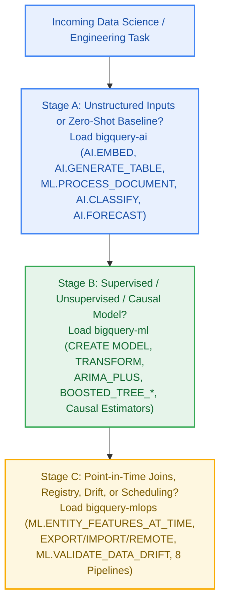

# Multi-Skill Composition Playbooks & Unified 32-Workflow Index

Contents: [1. When to combine multiple skills](#1-when-to-combine-multiple-skills) · [2. Six multi-skill composition playbooks (`bigquery-ai` + `bigquery-ml` + `bigquery-mlops`)](#2-six-multi-skill-composition-playbooks-bigquery-ai--bigquery-ml--bigquery-mlops) · [3. Unified 7-stage problem-first index of all 32 workflows & 8 pipelines](#3-unified-7-stage-problem-first-index-of-all-32-workflows--8-pipelines)

Real-world data science problems on BigQuery rarely stop at a single SQL namespace. A production system often extracts features from unstructured text or PDFs with **[`bigquery-ai`](../../bigquery-ai/SKILL.md)**, joins them point-in-time and trains an interpretable or high-throughput model with **[`bigquery-ml`](../../bigquery-ml/SKILL.md)**, and schedules drift detection, evaluation, and retraining with **[`bigquery-mlops`](../../bigquery-mlops/SKILL.md)**.

---

## 1. When to combine multiple skills

| Practitioner Scenario | Skills to Combine | Primary Handoff Surface |
| --- | --- | --- |
| Turn unstructured text, PDFs, or images into features for a tabular churn/fraud/LTV model | **`bigquery-ai` + `bigquery-ml` (+ `bigquery-mlops`)** | `AI.EMBED` / `AI.GENERATE_TABLE` / `ML.PROCESS_DOCUMENT` → `ML.ENTITY_FEATURES_AT_TIME` → `BOOSTED_TREE_CLASSIFIER` |
| Bootstrap labels with Gemini on a small sample, then train a fast, deterministic classifier for 100M rows | **`bigquery-ai` + `bigquery-ml` + `bigquery-mlops`** | `AI.CLASSIFY` / `AI.IF` teacher labels → `LOGISTIC_REG` / `BOOSTED_TREE_CLASSIFIER` student → `ML.METRICS` |
| Forecast, attribute metric drivers, or estimate causal impact, then write an executive narrative per segment | **`bigquery-ml` + `bigquery-ai`** | `ARIMA_PLUS` / `CONTRIBUTION_ANALYSIS` / `AI.CAUSAL_EFFECT` / `ML.EXPLAIN_PREDICT` → `AI.AGG(..., output_schema => ...)` |
| Retrieve candidate items via hybrid vector+lexical search, then re-rank with a trained propensity/recommendation model | **`bigquery-ai` + `bigquery-ml`** | `VECTOR_SEARCH` (`lexical_search_columns`) / `AI.SEARCH` (`mode => 'HYBRID'`) → `BOOSTED_TREE_CLASSIFIER` / `MATRIX_FACTORIZATION` |
| Monitor, evaluate, and summarize an external Vertex AI / Cloud Run model whose request-response logs land in BigQuery | **`bigquery-mlops` + `bigquery-ai`** | `ML.VALIDATE_DATA_DRIFT` + `ML.METRICS` on logged prediction tables → `AI.AGG` drift/accuracy brief → `vertex_kfp` / `cloud_workflows` |
| Take any worked `bigquery-ml` or `bigquery-ai` notebook and run it unattended on a production schedule | **`bigquery-ml` / `bigquery-ai` + `bigquery-mlops`** | Wrap SQL in `sql_scripting`, `scheduled_queries`, `dataform`, `cloud_workflows`, `dbt`, `vertex_kfp`, or `composer_airflow` |

---

## 2. Six multi-skill composition playbooks (`bigquery-ai` + `bigquery-ml` + `bigquery-mlops`)

### Playbook 1 — Unstructured Featurization → Point-in-Time Join → Supervised Model
- **Skills**: [`bigquery-ai`](../../bigquery-ai/SKILL.md) + [`bigquery-mlops`](../../bigquery-mlops/SKILL.md) + [`bigquery-ml`](../../bigquery-ml/SKILL.md)
- **Architecture**:
  1. **Extract or Embed (`bigquery-ai`)**: Convert raw unstructured text, support tickets, or `ObjectRef` PDFs/images into structured columns via `AI.GENERATE(..., output_schema => ...)` / `ML.PROCESS_DOCUMENT` or dense `ARRAY<FLOAT64>` vectors via `AI.EMBED(..., endpoint => 'text-embedding-005')` (or `model => 'embeddinggemma-300m'`).
  2. **Temporal Feature Join (`bigquery-mlops`)**: Join those timestamped unstructured features and tabular behavioral features to historical labeled events using `ML.ENTITY_FEATURES_AT_TIME` ([`feature-store-and-temporal-joins.md`](../../bigquery-mlops/reference/feature-store-and-temporal-joins.md)) so post-event tickets or documents never leak into training.
  3. **Supervised Training (`bigquery-ml`)**: Train a `BOOSTED_TREE_CLASSIFIER` or `LOGISTIC_REG` model combining the structured and embedding features.
- **Worked Ground-Truth Reference**: [`embeddings_classification.md`](../../bigquery-ml/narrative/embeddings_classification.md) (`bigquery-ml/workflows/embeddings_classification/`), which benchmarks a direct multiclass `BOOSTED_TREE_CLASSIFIER` on `AI.EMBED` vectors against a pairwise classifier and zero-training `VECTOR_SEARCH`.

### Playbook 2 — Zero-Shot Foundation Teacher → Trained Student Distillation
- **Skills**: [`bigquery-ai`](../../bigquery-ai/SKILL.md) + [`bigquery-ml`](../../bigquery-ml/SKILL.md) + [`bigquery-mlops`](../../bigquery-mlops/SKILL.md)
- **When to use**: You have millions of unlabeled rows and zero historical training labels, or `AI.PREDICT` (TabFM) hits its `<= 50` feature / `<= 10` class / non-determinism ceiling.
- **Architecture**:
  1. **Zero-Shot Teacher Labeling (`bigquery-ai`)**: Sample a stratified cohort (`WHERE MOD(ABS(FARM_FINGERPRINT(id)), 100) = 0`) Inside a CTE *before* calling `AI.CLASSIFY`, `AI.IF`, or `AI.SCORE` (or run `AI.PREDICT` for a zero-training tabular baseline).
  2. **High-Throughput Student Training (`bigquery-ml`)**: Train a deterministic `LOGISTIC_REG` or `BOOSTED_TREE_CLASSIFIER` (with `TRANSFORM(ML.TF_IDF(...) OVER(), ML.STANDARD_SCALER(...) OVER())` or `AI.EMBED` features) on the teacher-labeled cohort, then run `ML.PREDICT` across the full 100M-row table at fraction-of-a-cent slot cost.
  3. **Model-Free Parity Audit (`bigquery-mlops`)**: Materialize a holdout comparison table and score both teacher and student against a human-verified gold set using `ML.METRICS` ([`monitoring-drift-and-evaluation.md`](../../bigquery-mlops/reference/monitoring-drift-and-evaluation.md)).
- **Worked Ground-Truth References**: [`tabular_prediction.md`](../../bigquery-ai/narrative/tabular_prediction.md) (`bigquery-ai/workflows/tabular_prediction/`) and [`embeddings_classification.md`](../../bigquery-ml/narrative/embeddings_classification.md).

### Playbook 3 — Quantitative Model / Causal Attribution → Generative Executive Brief
- **Skills**: [`bigquery-ml`](../../bigquery-ml/SKILL.md) + [`bigquery-ai`](../../bigquery-ai/SKILL.md)
- **When to use**: Stakeholders need both **mathematically rigorous numbers** (forecasts with prediction intervals, Shapley attributions, segment driver lift, or causal p-values) and a **plain-English executive narrative** explaining what moved and why.
- **Architecture**:
  1. **Quantitative Stage (`bigquery-ml` or `bigquery-ai` Predictive/Causal)**: Run `ARIMA_PLUS` + `ML.EXPLAIN_FORECAST`, `CONTRIBUTION_ANALYSIS` + `ML.GET_INSIGHTS` (or `AI.KEY_DRIVERS` for `<= 12` dimensions), `AI.CAUSAL_EFFECT` / `difference_in_differences`, or `ML.EXPLAIN_PREDICT`.
  2. **Structured Synthesis Stage (`bigquery-ai`)**: Pass the top attributed segments, anomalies, or forecast deltas into `AI.AGG(..., output_schema => 'headline STRING, key_risks ARRAY<STRING>, recommended_actions ARRAY<STRING>')` or `AI.GENERATE` to synthesize a grounded narrative without allowing the LLM to invent arithmetic.
- **Worked Ground-Truth References**: [`metric_diagnostics.md`](../../bigquery-ai/narrative/metric_diagnostics.md) (`bigquery-ai/workflows/metric_diagnostics/`) and [`time_series_intelligence.md`](../../bigquery-ai/narrative/time_series_intelligence.md) (`bigquery-ai/workflows/time_series_intelligence/`).

### Playbook 4 — Hybrid Retrieval (`VECTOR_SEARCH` / `AI.SEARCH`) + Learned Re-Ranking
- **Skills**: [`bigquery-ai`](../../bigquery-ai/SKILL.md) + [`bigquery-ml`](../../bigquery-ml/SKILL.md)
- **When to use**: Semantic search misses exact SKU/error-code matches, and pure RRF hybrid search needs business-metric re-ranking (conversion propensity, click-through rate, or collaborative filtering affinity).
- **Architecture**:
  1. **Candidate Generation (`bigquery-ai`)**: Retrieve the top `K` candidates per query using `VECTOR_SEARCH(..., options => '{"lexical_search_columns": [...]}')` or `AI.SEARCH(..., mode => 'HYBRID')`, sizing `top_k >= R/10` for target semantic rank `R` ([`catalog_search.md`](../../bigquery-ai/narrative/catalog_search.md)).
  2. **Learned or Rubric Re-Ranking (`bigquery-ml` / `bigquery-ai`)**: Score the candidate pool using a trained `BOOSTED_TREE_CLASSIFIER` propensity model, `MATRIX_FACTORIZATION` (`ML.RECOMMEND` affinity score in [`recommendation.md`](../../bigquery-ml/narrative/recommendation.md)), or `AI.SCORE` rubric re-ranker.

### Playbook 5 — External Vertex AI / Custom Model Monitored & Evaluated in BigQuery
- **Skills**: [`bigquery-mlops`](../../bigquery-mlops/SKILL.md) + [`bigquery-ai`](../../bigquery-ai/SKILL.md)
- **When to use**: A model is trained or served outside BigQuery (Vertex AI Online Endpoints, Cloud Run, GKE, or a third-party API) and logs its inference requests/responses to a BigQuery table.
- **Architecture**:
  1. **Feature & Prediction Drift Gate (`bigquery-mlops`)**: Run 3-argument `ML.VALIDATE_DATA_DRIFT(TABLE baseline, TABLE recent_logs, STRUCT(...))` alongside `ML.DESCRIBE_DATA` (no `MODEL` object needed).
  2. **Delayed Ground-Truth Evaluation (`bigquery-mlops`)**: Join logged predictions with actual outcomes into a materialized table (casting binary labels/predictions to `BOOL`) and compute `ML.METRICS`.
  3. **Automated Incident Triage (`bigquery-ai` + `bigquery-mlops`)**: Summarize drifted features and segment accuracy drops with `AI.AGG` and trigger a conditional retraining pipeline in `cloud_workflows`, `vertex_kfp`, or `composer_airflow` ([`orchestration-and-pipelines.md`](../../bigquery-mlops/reference/orchestration-and-pipelines.md)).

### Playbook 6 — End-to-End Production Operationalization
- **Skills**: [`bigquery-ml`](../../bigquery-ml/SKILL.md) / [`bigquery-ai`](../../bigquery-ai/SKILL.md) + [`bigquery-mlops`](../../bigquery-mlops/SKILL.md)
- **Architecture**: Take any worked workflow from the table below, add a pre-retrain `ML.VALIDATE_DATA_DRIFT` gate and a post-retrain `ML.EVALUATE` / `ML.METRICS` gate (with `useQueryCache = false` / `'false'`), and deploy it into one of the 8 production orchestrators in [`orchestration-and-pipelines.md`](../../bigquery-mlops/reference/orchestration-and-pipelines.md).

---

## 3. Unified 7-stage problem-first index of all 32 workflows & 8 pipelines

Use this master index to find every end-to-end workflow and orchestration pipeline across **both** `bigquery-ml/` and `bigquery-ai/` by the data science stage you are solving:

| Lifecycle Stage | Problem / Use Case | Primary Skill(s) | Key SQL Symbols | Walkthrough (Lens 4) | Source Folder |
| --- | --- | --- | --- | --- | --- |
| **1. Data Exploration & Diagnostics** | Dataset profiling, hidden placeholder nulls & segmented rank correlation | `bigquery-ml` | `ML.DESCRIBE_DATA`, `ML.CORRELATION` | [`exploration.md`](../../bigquery-ml/narrative/exploration.md) | `bigquery-ml/functions/exploration/` |
| **1. Data Exploration & Diagnostics** | Model-free time-series trend, seasonality & structural break decomposition | `bigquery-ml` | `ML.TREND`, `ML.SEASONALITY`, `ML.DETECT_CHANGE_POINTS` | [`time_series.md`](../../bigquery-ml/narrative/time_series.md) | `bigquery-ml/functions/time_series/` |
| **1. Data Exploration & Diagnostics** | Explain why a metric moved across segments, project forward & narrate | `bigquery-ai` + `bigquery-ml` | `AI.KEY_DRIVERS`, `AI.PREDICT`, `AI.CAUSAL_EFFECT`, `AI.GENERATE` | [`metric_diagnostics.md`](../../bigquery-ai/narrative/metric_diagnostics.md) | `bigquery-ai/workflows/metric_diagnostics/` |
| **2. Feature Store & Preprocessing** | Point-in-time feature store mechanics across sparse, dense & EAV tables | `bigquery-mlops` + `bigquery-ml` | `ML.ENTITY_FEATURES_AT_TIME`, `ML.FEATURES_AT_TIME` | [`feature_store.md`](../../bigquery-ml/narrative/feature_store.md) | `bigquery-ml/functions/feature_store/` |
| **2. Feature Store & Preprocessing** | 3-arm training/serving skew audit (`0.9387` leaky vs `0.5194` honest) | `bigquery-mlops` + `bigquery-ml` | `ML.ENTITY_FEATURES_AT_TIME`, `ML.FEATURES_AT_TIME`, `LOGISTIC_REG` | [`feature_store_workflow.md`](../../bigquery-ml/narrative/feature_store_workflow.md) | `bigquery-ml/workflows/feature_store/` |
| **2. Feature Store & Preprocessing** | Grounded web lookup & zero-shot tabular imputation for dirty records | `bigquery-ai` | `AI.GENERATE` (Search grounding + `output_schema`), `AI.PREDICT` | [`data_enrichment.md`](../../bigquery-ai/narrative/data_enrichment.md) | `bigquery-ai/workflows/data_enrichment/` |
| **2. Feature Store & Preprocessing** | Near-duplicate image detection to protect train/test split integrity | `bigquery-ai` | `AI.EMBED`, `VECTOR_SEARCH` | [`image_deduplication.md`](../../bigquery-ai/narrative/image_deduplication.md) | `bigquery-ai/workflows/image_deduplication/` |
| **3. Supervised, Unsupervised & Time-Series ML** | Order-lapse customer churn prediction & threshold vs `roc_auc` literacy | `bigquery-ml` | `BOOSTED_TREE_CLASSIFIER`, `ML.EVALUATE`, `ML.EXPLAIN_PREDICT` | [`churn_retention.md`](../../bigquery-ml/narrative/churn_retention.md) | `bigquery-ml/workflows/churn_retention/` |
| **3. Supervised, Unsupervised & Time-Series ML** | GA4 behavioral engagement churn prediction (base for all 8 pipelines) | `bigquery-ml` + `bigquery-mlops` | `BOOSTED_TREE_CLASSIFIER`, `ML.GLOBAL_EXPLAIN`, `ML.EXPLAIN_PREDICT` | [`ga4_churn_prediction.md`](../../bigquery-ml/narrative/ga4_churn_prediction.md) | `bigquery-ml/workflows/ga4_churn_prediction/` |
| **3. Supervised, Unsupervised & Time-Series ML** | RFM customer segmentation into interpretable personas | `bigquery-ml` | `KMEANS`, `ML.STANDARD_SCALER`, `ML.CENTROIDS` | [`customer_segmentation.md`](../../bigquery-ml/narrative/customer_segmentation.md) | `bigquery-ml/workflows/customer_segmentation/` |
| **3. Supervised, Unsupervised & Time-Series ML** | Collaborative filtering recommendation & cold-start fallback analysis | `bigquery-ml` | `MATRIX_FACTORIZATION`, `ML.RECOMMEND`, `ML.EVALUATE` | [`recommendation.md`](../../bigquery-ml/narrative/recommendation.md) | `bigquery-ml/workflows/recommendation/` |
| **3. Supervised, Unsupervised & Time-Series ML** | Unsupervised vs supervised credit-card fraud detection | `bigquery-ml` | `PCA`, `AUTOENCODER`, `BOOSTED_TREE_CLASSIFIER`, `ML.DETECT_ANOMALIES` | [`anomaly_fraud_detection.md`](../../bigquery-ml/narrative/anomaly_fraud_detection.md) | `bigquery-ml/workflows/anomaly_fraud_detection/` |
| **3. Supervised, Unsupervised & Time-Series ML** | Deterministic 5-fold cross-validation in pure SQL | `bigquery-ml` | `LOGISTIC_REG`, `FARM_FINGERPRINT`, `ML.EVALUATE` | [`cross_validation.md`](../../bigquery-ml/narrative/cross_validation.md) | `bigquery-ml/workflows/cross_validation/` |
| **3. Supervised, Unsupervised & Time-Series ML** | Stacked meta-learner vs simple-average model ensembling | `bigquery-ml` | `LOGISTIC_REG`, `BOOSTED_TREE_CLASSIFIER`, `RANDOM_FOREST_CLASSIFIER` | [`ensembling.md`](../../bigquery-ml/narrative/ensembling.md) | `bigquery-ml/workflows/ensembling/` |
| **3. Supervised, Unsupervised & Time-Series ML** | Kaplan-Meier, discrete-time hazard & `lifelines` Cox PH survival analysis | `bigquery-ml` | `LOGISTIC_REG`, `ML.PREDICT`, `ML.WEIGHTS` (+ `lifelines`) | [`survival_analysis.md`](../../bigquery-ml/narrative/survival_analysis.md) | `bigquery-ml/workflows/survival_analysis/` |
| **3. Supervised, Unsupervised & Time-Series ML** | Lag/lead feature-engineered regression forecasting vs `ARIMA_PLUS` | `bigquery-ml` | `LINEAR_REG`, `BOOSTED_TREE_REGRESSOR`, `ML.PREDICT` | [`regression_based_forecasting.md`](../../bigquery-ml/narrative/regression_based_forecasting.md) | `bigquery-ml/workflows/regression_based_forecasting/` |
| **3. Supervised, Unsupervised & Time-Series ML** | Bottom-up `hierarchical_time_series_cols` vs top-down forecasting | `bigquery-ml` | `ARIMA_PLUS`, `ML.FORECAST`, `ML.EVALUATE` | [`hierarchical_forecasting.md`](../../bigquery-ml/narrative/hierarchical_forecasting.md) | `bigquery-ml/workflows/hierarchical_forecasting/` |
| **4. Foundation AI, Search & Multimodal** | Zero-shot TabFM tabular regression/classification vs trained BQML | `bigquery-ai` + `bigquery-ml` | `AI.PREDICT`, `AI.EVALUATE`, `AI.KEY_DRIVERS`, `AI.GENERATE` | [`tabular_prediction.md`](../../bigquery-ai/narrative/tabular_prediction.md) | `bigquery-ai/workflows/tabular_prediction/` |
| **4. Foundation AI, Search & Multimodal** | Zero-shot forecasting, anomaly detection, evaluation & segment drivers | `bigquery-ai` | `AI.FORECAST`, `AI.DETECT_ANOMALIES`, `AI.EVALUATE`, `AI.KEY_DRIVERS` | [`time_series_intelligence.md`](../../bigquery-ai/narrative/time_series_intelligence.md) | `bigquery-ai/workflows/time_series_intelligence/` |
| **4. Foundation AI, Search & Multimodal** | Embeddings as features for hierarchical product classification | `bigquery-ml` + `bigquery-ai` | `AI.EMBED`, `BOOSTED_TREE_CLASSIFIER`, `VECTOR_SEARCH` | [`embeddings_classification.md`](../../bigquery-ml/narrative/embeddings_classification.md) | `bigquery-ml/workflows/embeddings_classification/` |
| **4. Foundation AI, Search & Multimodal** | Semantic search three ways: manual, autonomous `AI.SEARCH`, and hybrid | `bigquery-ai` | `AI.EMBED`, `VECTOR_SEARCH`, `AI.SEARCH` | [`semantic_search.md`](../../bigquery-ai/narrative/semantic_search.md) | `bigquery-ai/workflows/semantic_search/` |
| **4. Foundation AI, Search & Multimodal** | Hybrid RRF catalog search & exact-token SKU reach math | `bigquery-ai` | `AI.EMBED`, `VECTOR_SEARCH` (`lexical_search_columns`), `AI.SEARCH` | [`catalog_search.md`](../../bigquery-ai/narrative/catalog_search.md) | `bigquery-ai/workflows/catalog_search/` |
| **4. Foundation AI, Search & Multimodal** | End-to-end Retrieval-Augmented Generation (RAG) over text | `bigquery-ai` | `AI.GENERATE_TABLE`, `AI.EMBED`, `VECTOR_SEARCH`, `AI.GENERATE` | [`rag_pipeline.md`](../../bigquery-ai/narrative/rag_pipeline.md) | `bigquery-ai/workflows/rag_pipeline/` |
| **4. Foundation AI, Search & Multimodal** | Document classification, schema extraction, quality scoring & synthesis | `bigquery-ai` | `AI.CLASSIFY`, `AI.GENERATE`, `AI.SCORE`, `AI.AGG` | [`document_intelligence.md`](../../bigquery-ai/narrative/document_intelligence.md) | `bigquery-ai/workflows/document_intelligence/` |
| **4. Foundation AI, Search & Multimodal** | Document RAG *(historical record; use `ML.PROCESS_DOCUMENT` for new work)* | `bigquery-ai` | `ML.PROCESS_DOCUMENT` *(replaces retired `AI.PARSE_DOCUMENT`)*, `AI.EMBED`, `VECTOR_SEARCH` | [`document_rag.md`](../../bigquery-ai/narrative/document_rag.md) | `bigquery-ai/workflows/document_rag/` |
| **4. Foundation AI, Search & Multimodal** | Content analysis: generate, classify, score & summarize at scale | `bigquery-ai` | `AI.GENERATE_TABLE`, `AI.CLASSIFY`, `AI.SCORE`, `AI.GENERATE`, `AI.AGG` | [`content_analysis.md`](../../bigquery-ai/narrative/content_analysis.md) | `bigquery-ai/workflows/content_analysis/` |
| **4. Foundation AI, Search & Multimodal** | User-generated content moderation pipeline | `bigquery-ai` | `AI.IF`, `AI.CLASSIFY`, `AI.SCORE`, `AI.GENERATE`, `AI.AGG` | [`content_moderation.md`](../../bigquery-ai/narrative/content_moderation.md) | `bigquery-ai/workflows/content_moderation/` |
| **4. Foundation AI, Search & Multimodal** | Multimodal document image embedding, similarity & visual description | `bigquery-ai` | `AI.EMBED`, `AI.SIMILARITY`, `AI.GENERATE` (`ObjectRef`) | [`multimodal_analysis.md`](../../bigquery-ai/narrative/multimodal_analysis.md) | `bigquery-ai/workflows/multimodal_analysis/` |
| **4. Foundation AI, Search & Multimodal** | Support log triage, severity scoring, `AI.AGG` synthesis & hybrid search | `bigquery-ai` | `AI.CLASSIFY`, `AI.SCORE`, `AI.AGG`, `AI.EMBED`, `VECTOR_SEARCH` | [`log_analysis.md`](../../bigquery-ai/narrative/log_analysis.md) | `bigquery-ai/workflows/log_analysis/` |
| **5. Causal Inference & Attribution** | Propensity score matching & IPTW on observational data | `bigquery-ml` | `LOGISTIC_REG`, `ML.PREDICT`, `ML.EVALUATE` | [`propensity_score_matching.md`](../../bigquery-ml/narrative/propensity_score_matching.md) | `bigquery-ml/workflows/propensity_score_matching/` |
| **5. Causal Inference & Attribution** | Double Machine Learning (DML) for de-confounded price elasticity | `bigquery-ml` | `BOOSTED_TREE_REGRESSOR`, `LINEAR_REG`, `ML.WEIGHTS` | [`price_elasticity_dml.md`](../../bigquery-ml/narrative/price_elasticity_dml.md) | `bigquery-ml/workflows/price_elasticity_dml/` |
| **5. Causal Inference & Attribution** | Heterogeneous treatment effect / CATE uplift modeling (T-Learner) | `bigquery-ml` | `BOOSTED_TREE_CLASSIFIER`, `ML.PREDICT` | [`uplift_cate.md`](../../bigquery-ml/narrative/uplift_cate.md) | `bigquery-ml/workflows/uplift_cate/` |
| **5. Causal Inference & Attribution** | Difference-in-Differences (`NORMAL_EQUATION` & staggered TWFE fix) | `bigquery-ml` | `LINEAR_REG` (`optimize_strategy='NORMAL_EQUATION'`) | [`difference_in_differences.md`](../../bigquery-ml/narrative/difference_in_differences.md) | `bigquery-ml/workflows/difference_in_differences/` |
| **5. Causal Inference & Attribution** | Synthetic control counterfactual weighting | `bigquery-ml` | `LINEAR_REG` (+ constrained `scipy.optimize` simplex fit) | [`synthetic_control.md`](../../bigquery-ml/narrative/synthetic_control.md) | `bigquery-ml/workflows/synthetic_control/` |
| **5. Causal Inference & Attribution** | Interrupted time-series counterfactual (`AI.CAUSAL_EFFECT` vs `ARIMA_PLUS`) | `bigquery-ml` + `bigquery-ai` | `AI.CAUSAL_EFFECT`, `ARIMA_PLUS`, `ML.FORECAST` | [`causal_effect.md`](../../bigquery-ml/narrative/causal_effect.md) | `bigquery-ml/workflows/causal_effect/` |
| **6. Evaluation & Monitoring** | Model-free table evaluation (`ML.METRICS`) & dataset drift monitoring | `bigquery-mlops` + `bigquery-ml` | `ML.METRICS`, `ML.VALIDATE_DATA_DRIFT`, `ML.VALIDATE_DATA_SKEW` | [`evaluation.md`](../../bigquery-ml/narrative/evaluation.md) · [`model_monitoring.md`](../../bigquery-ml/narrative/model_monitoring.md) | `bigquery-ml/functions/{evaluation,model_monitoring}/` |
| **7. Production MLOps Pipelines (8)** | Drift-gated conditional retrain & batch scoring across 8 orchestrators | `bigquery-mlops` + `bigquery-ml` | `sql_scripting`, `scheduled_queries`, `dataform`, `cloud_workflows`, `dbt`, `vertex_kfp`, `composer_airflow`, `airflow_with_kfp` | [`orchestration-and-pipelines.md`](../../bigquery-mlops/reference/orchestration-and-pipelines.md) | `bigquery-ml/pipelines/*/` |
