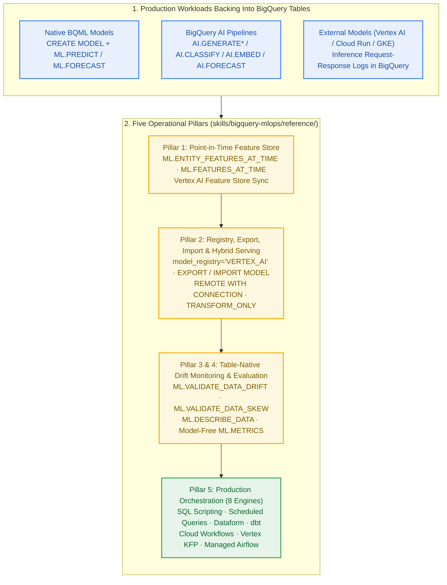

# BigQuery MLOps & Production Operations (`bigquery-mlops`)

BigQuery MLOps operationalizes **three distinct production workloads** using one unified SQL and GCP control plane:

1. **Native BigQuery ML Models (`CREATE MODEL` + `ML.*`)** — scheduled drift checks, conditional retraining, model-registry versioning, artifact export/import, and point-in-time feature serving.
2. **BigQuery AI Foundation Workflows (`AI.*`, `VECTOR_SEARCH`, `ML.PROCESS_DOCUMENT`)** — recurring batch enrichment (`AI.CLASSIFY`, `AI.SCORE`, `AI.GENERATE_TABLE`), scheduled `AI.FORECAST` / `AI.DETECT_ANOMALIES` runs, incremental `AI.EMBED` + `ALTER VECTOR INDEX` maintenance, and `ARRAY<FLOAT64>` embedding drift monitoring.
3. **External Models Logging to BigQuery (Vertex AI Endpoints, Cloud Run, GKE, Vendor APIs)** — because `ML.VALIDATE_DATA_DRIFT`, `ML.DESCRIBE_DATA`, `ML.METRICS`, and `ML.FEATURES_AT_TIME` operate directly on **BigQuery tables with no `MODEL` object required**, BigQuery serves as a zero-infrastructure monitoring, evaluation, and feature-store plane for models served anywhere that log inference requests and ground-truth labels to BigQuery.

## Decision Tree (Lens 1 → Lens 2)

1. **Are you scheduling or orchestrating a multi-step ML or AI workflow** (drift check → conditional `CREATE OR REPLACE MODEL` retrain → `ML.EVALUATE` gate → batch `ML.PREDICT` / `AI.*` scoring, or incremental `AI.EMBED` refresh)?
   - Choose among the **8 production orchestrators** (`sql_scripting`, `scheduled_queries`, `dataform`, `cloud_workflows`, `dbt`, `vertex_kfp`, `composer_airflow`, `airflow_with_kfp`) → see [`reference/orchestration-and-pipelines.md`](reference/orchestration-and-pipelines.md).
2. **Are you registering a model in Vertex AI Model Registry, exporting a BQML model to GCS, importing an external ONNX/XGBoost/TensorFlow/TFLite model into BigQuery, or calling a custom Vertex AI Endpoint via `REMOTE WITH CONNECTION`?**
   - See [`reference/model-registry-export-and-serving.md`](reference/model-registry-export-and-serving.md).
3. **Are you monitoring feature/embedding/prediction drift (`ML.VALIDATE_DATA_DRIFT`, `ML.VALIDATE_DATA_SKEW`) or computing accuracy metrics (`ML.METRICS`, `ML.EVALUATE`, `AI.EVALUATE`) on saved prediction tables — including predictions logged from external Vertex AI or microservice endpoints?**
   - See [`reference/monitoring-drift-and-evaluation.md`](reference/monitoring-drift-and-evaluation.md).
4. **Are you assembling leak-free point-in-time training sets (`ML.ENTITY_FEATURES_AT_TIME`), serving low-latency online/batch feature vectors (`ML.FEATURES_AT_TIME` or Vertex AI Feature Store), or auditing a pipeline for training/serving skew?**
   - See [`reference/feature-store-and-temporal-joins.md`](reference/feature-store-and-temporal-joins.md).

## Composing With Sister Skills (`bigquery-data-science`, `bigquery-ml`, `bigquery-ai`)

| When Your MLOps Task Needs... | Combine `bigquery-mlops` With... | Why & Where to Look |
| --- | --- | --- |
| Choosing which `CREATE MODEL` estimator to train or tune inside a retraining pipeline | **[`bigquery-ml`](../bigquery-ml/SKILL.md)** | `bigquery-mlops` owns the orchestration, drift gate, registry, and serving topology; `bigquery-ml` owns the 23 model types (`classification.md`, `regression.md`, `unsupervised-and-specialized.md`). |
| Orchestrating or monitoring `AI.GENERATE*`, `AI.CLASSIFY`, `AI.EMBED`, `VECTOR_SEARCH`, `AI.FORECAST`, or `AI.PREDICT` | **[`bigquery-ai`](../bigquery-ai/SKILL.md)** | `bigquery-ai` owns foundation-model prompt/schema design, RRF hybrid search sizing, and pinned endpoints (`skills/pinned-models.json`); `bigquery-mlops` schedules them, monitors `ARRAY<FLOAT64>` drift, and scores saved predictions via `ML.METRICS`. |
| Multi-stage hybrid architectures (e.g., `AI.EMBED` featurization → `ML.ENTITY_FEATURES_AT_TIME` → `BOOSTED_TREE_*` → `AI.AGG` drift alert summary) | **[`bigquery-data-science`](../bigquery-data-science/SKILL.md)** | Read [`../bigquery-data-science/reference/cross-skill-playbooks.md`](../bigquery-data-science/reference/cross-skill-playbooks.md) for 6 end-to-end multi-skill playbooks and the unified 32-workflow + 8-pipeline index. |

## Tool Wrapper & Generator Rules (SQL + Python Control Plane)

- **Always Bypass the Query Cache After Retraining or Table Replacement**: Any orchestrator or notebook running `ML.EVALUATE`, `ML.METRICS`, or `ML.VALIDATE_DATA_DRIFT` after `CREATE OR REPLACE MODEL` (or `CREATE OR REPLACE TABLE`) must disable the BigQuery query cache. Use `useQueryCache: false` in `google-cloud-bigquery` / Cloud Workflows / Airflow `BigQueryInsertJobOperator`, and use the **string `'false'`** in `google_cloud_pipeline_components` Vertex KFP ops (whose JSON cleaner silently strips boolean `False`).
- **Pin `xgboost_version = '2.1'` for Exportable Tree Models**: Whenever a `BOOSTED_TREE_*` or `RANDOM_FOREST_*` model may be exported via `EXPORT MODEL` or registered to Vertex AI, set `xgboost_version = '2.1'` at training time so BigQuery emits modern `model.ubj` instead of legacy `0.9` `model.bst`.
- **Use 3-Argument Model-Free `ML.VALIDATE_DATA_DRIFT` for Universal Monitoring**: The 3-argument signature `ML.VALIDATE_DATA_DRIFT(TABLE baseline, TABLE comparison, STRUCT(...))` requires no `MODEL` object, no Cloud Resource Connection, and no Vertex AI Model Registry registration — making it work identically on BQML features, `AI.*` outputs/embeddings, and external Vertex AI / Cloud Run inference logs.
- **Enforce Real Infrastructure Teardown**: Every script or notebook that provisions billable control-plane resources (Vertex AI Endpoints, Vertex AI Feature Store online serving nodes, Managed Airflow environments + their orphaned GCS buckets, or temporary `ENTERPRISE` autoscale reservations) must include explicit teardown commands.

## Reviewer Verification Checklist & Rubric

Before returning any MLOps SQL, DAG, workflow YAML, or Python pipeline code, verify against this checklist:

- [ ] **No Leaky `GROUP BY` Feature Joins**: Training set assembly over time-varying features uses `ML.ENTITY_FEATURES_AT_TIME` (never `GROUP BY entity_id` latest-row joins) and sets `ignore_feature_nulls` to match table shape (`TRUE` for sparse/EAV updates, `FALSE` for dense snapshots) while re-joining the label on `(entity_id, feature_timestamp)`.
- [ ] **No Unordered `LIMIT` Sampling in Drift/Skew Checks**: Baseline and serving comparison slices passed to `ML.VALIDATE_DATA_DRIFT` or `ML.VALIDATE_DATA_SKEW` use deterministic time windows or `WHERE RAND() < p` (never `SELECT * FROM ... LIMIT N` without `ORDER BY`, which manufactures false skew alarms on storage-clustered tables).
- [ ] **Numeric Drift Range Check Included**: When alerting on numeric `JENSEN_SHANNON_DIVERGENCE` in `ML.VALIDATE_DATA_DRIFT`, pair it with `ML.DESCRIBE_DATA` (`min`/`max`) or `ML.BUCKETIZE` with fixed split points so a single outlier shifting the 10-bucket histogram grid does not trigger a false retrain.
- [ ] **`ML.METRICS` Label & Prediction Type Parity**: Callers of `ML.METRICS` (and `AI.EVALUATE`) cast binary labels/predictions deliberately (`BOOL` scores positive-class binary precision/recall; `STRING` scores 2-class macro-averaged precision/recall) and materialize inputs to a `TABLE` rather than an inline `(QUERY)` to avoid internal error `80038528`.
- [ ] **Safe Vertex AI Endpoint Deployment Path**: Do not rely on `model_registry = 'VERTEX_AI'` + direct one-click endpoint deploy for `LOGISTIC_REG` (which bakes in a broken Sampled-Shapley `explanationSpec`); use `EXPORT MODEL` → `aiplatform.Model.upload()` → `endpoint.deploy()` when serving online via Vertex AI Endpoints.

## Cross-Cutting Empirical Gotchas

- **Query-cache staleness hides retraining regressions**: A byte-identical `ML.EVALUATE` query executed before and after `CREATE OR REPLACE MODEL` returns the *pre-retrain* cached metrics unless `use_query_cache=False` (or `'false'` in KFP `google_cloud_pipeline_components`) is passed.
- **Single-row min/max shift flips numeric `ML.VALIDATE_DATA_DRIFT` by 4.5x**: Numeric drift computes base-2 JSD over two independent 10-bucket equal-width histograms spanned by each input's own `[min, max]`. Adding a single row with `education_num = 1` to a 1,116-row comparison set shifts the reported JSD from `0.181256` (`is_anomaly = TRUE`) to `0.036175` (`FALSE`).
- **`ML.METRICS` outlives `DROP MODEL` and scores external models, but column type changes the math**: Verified live that after `DROP MODEL`, `ML.EVALUATE` fails with `Not found: Model` while `ML.METRICS` matches `ML.EVALUATE` to 13+ significant digits. However, the identical 62 predictions score precision `0.5238` as `BOOL` and `0.7497` as `STRING`.
- **ONNX and XGBoost import/export version gates**: `ONNX` import requires ONNX Runtime 1.12.0 compatibility (`target_opset=13`, `ir_version=8`, and `zipmap=False` for scikit-learn classifiers). `XGBOOST` import accepts `.json` / `.ubj` and rejects `.bst` regardless of `xgboost` library version; `EXPORT MODEL` strips `feature_names` (`f0`, `f1`, ...).
- **`ML.FEATURE_CROSS` and `ML.POLYNOMIAL_EXPAND` block `EXPORT MODEL`**: Models using either function inside `TRANSFORM(...)` train and predict in BigQuery but fail `EXPORT MODEL` and Vertex AI Registry sync with `400 Model TRANSFORM contains unsupported function for exporting`.
- **Managed Airflow (Cloud Composer Gen 3) leaves an orphaned GCS bucket on delete**: Deleting the Airflow environment via API/CLI does not delete its Cloud Storage bucket; always delete the bucket explicitly during teardown.

## 4-Lens Index

- **Lens 2 — Operational Decision Guides (`reference/`)**:
  - [`reference/orchestration-and-pipelines.md`](reference/orchestration-and-pipelines.md) — Choosing and wiring the 8 production orchestrators across both `ML.*` and `AI.*`, cache-bypass rules, Managed Airflow Gen 3 sizing, and teardown patterns
  - [`reference/model-registry-export-and-serving.md`](reference/model-registry-export-and-serving.md) — Vertex AI Model Registry (`model_registry='VERTEX_AI'`), `EXPORT MODEL`, `IMPORT MODEL` (`ONNX`, `XGBOOST`, `TENSORFLOW`, `TENSORFLOW_LITE`), `REMOTE WITH CONNECTION`, and `TRANSFORM_ONLY`
  - [`reference/monitoring-drift-and-evaluation.md`](reference/monitoring-drift-and-evaluation.md) — Universal table-native drift/skew monitoring (`ML.VALIDATE_DATA_DRIFT`, `ML.VALIDATE_DATA_SKEW`, `ML.DESCRIBE_DATA`) and model-free evaluation (`ML.METRICS`, `ML.EVALUATE`, `AI.EVALUATE`) for BQML, `AI.*`, and external models logging to BigQuery
  - [`reference/feature-store-and-temporal-joins.md`](reference/feature-store-and-temporal-joins.md) — Point-in-time feature store (`ML.ENTITY_FEATURES_AT_TIME`, `ML.FEATURES_AT_TIME`), table-shape rules (`ignore_feature_nulls`), the 3-arm skew audit, and Vertex AI Feature Store sync
- **Lens 3 — Per-Statement Syntax Cards (`../bigquery-ml/syntax/` & `../bigquery-ai/syntax/`)**:
  - [`../bigquery-ml/syntax/INDEX.md`](../bigquery-ml/syntax/INDEX.md) — [`export-model.md`](../bigquery-ml/syntax/export-model.md), [`imported-models-tensorflow-tensorflow_lite-onnx-xgboost.md`](../bigquery-ml/syntax/imported-models-tensorflow-tensorflow_lite-onnx-xgboost.md), [`remote-remote-model-over-a-vertex-ai-endpoint-the-mechanism.md`](../bigquery-ml/syntax/remote-remote-model-over-a-vertex-ai-endpoint-the-mechanism.md), [`transform_only.md`](../bigquery-ml/syntax/transform_only.md), [`mlvalidate_data_drift.md`](../bigquery-ml/syntax/mlvalidate_data_drift.md), [`mlvalidate_data_skew.md`](../bigquery-ml/syntax/mlvalidate_data_skew.md), [`mlmetrics.md`](../bigquery-ml/syntax/mlmetrics.md), [`mlentity_features_at_time.md`](../bigquery-ml/syntax/mlentity_features_at_time.md), [`mlfeatures_at_time.md`](../bigquery-ml/syntax/mlfeatures_at_time.md)
  - [`../bigquery-ai/syntax/INDEX.md`](../bigquery-ai/syntax/INDEX.md) — [`aievaluate.md`](../bigquery-ai/syntax/aievaluate.md), [`aiembed.md`](../bigquery-ai/syntax/aiembed.md), [`vector_search.md`](../bigquery-ai/syntax/vector_search.md)
- **Lens 4 — Worked Walkthroughs (`../bigquery-ml/narrative/` & `../bigquery-ai/narrative/`)**:
  - Pipelines: [`sql_scripting.md`](../bigquery-ml/narrative/sql_scripting.md), [`scheduled_queries.md`](../bigquery-ml/narrative/scheduled_queries.md), [`dataform.md`](../bigquery-ml/narrative/dataform.md), [`cloud_workflows.md`](../bigquery-ml/narrative/cloud_workflows.md), [`dbt.md`](../bigquery-ml/narrative/dbt.md), [`vertex_kfp.md`](../bigquery-ml/narrative/vertex_kfp.md), [`composer_airflow.md`](../bigquery-ml/narrative/composer_airflow.md), [`airflow_with_kfp.md`](../bigquery-ml/narrative/airflow_with_kfp.md)
  - Registry, Serving, Monitoring & Feature Store: [`export.md`](../bigquery-ml/narrative/export.md), [`imported.md`](../bigquery-ml/narrative/imported.md), [`remote.md`](../bigquery-ml/narrative/remote.md), [`transform_only.md`](../bigquery-ml/narrative/transform_only.md), [`model_monitoring.md`](../bigquery-ml/narrative/model_monitoring.md), [`evaluation.md`](../bigquery-ml/narrative/evaluation.md), [`feature_store.md`](../bigquery-ml/narrative/feature_store.md), [`feature_store_workflow.md`](../bigquery-ml/narrative/feature_store_workflow.md)
