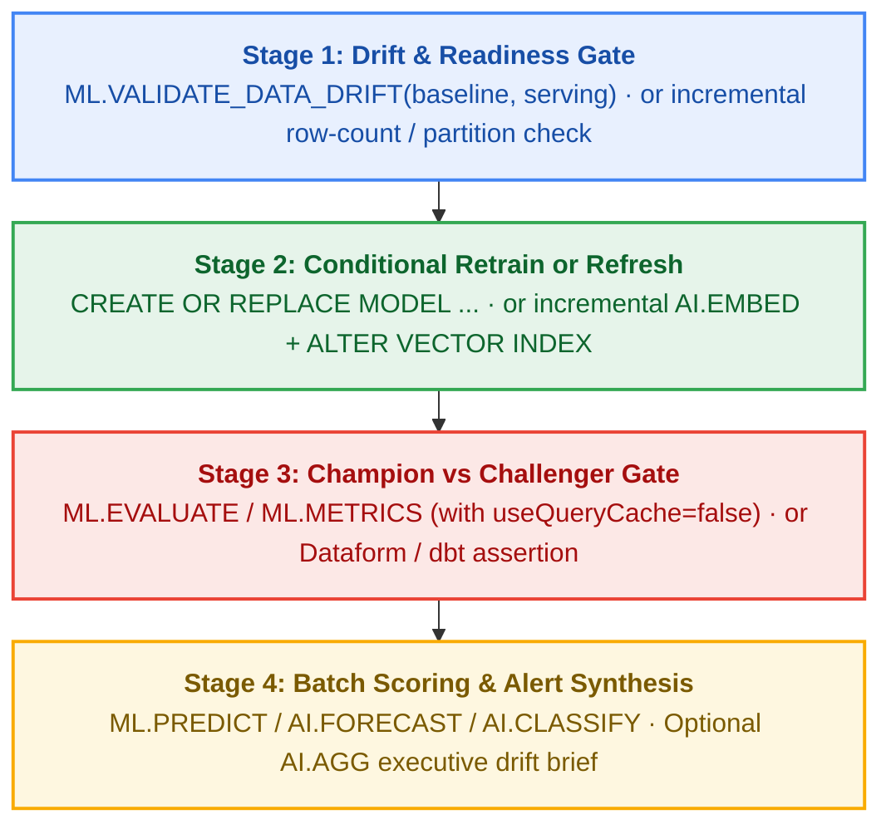

# Production Orchestration & Retraining Pipelines Across `ML.*` and `AI.*`

Contents: [1. Choosing among the 8 orchestrators](#1-choosing-among-the-8-orchestrators) · [2. Standard 4-stage MLOps & AI pipeline pattern](#2-standard-4-stage-mlops--ai-pipeline-pattern) · [3. Orchestrating BigQuery AI (`AI.*`) workloads](#3-orchestrating-bigquery-ai-ai-workloads) · [4. Query-cache bypass rules across engines](#4-query-cache-bypass-rules-across-engines) · [5. Verified empirical gotchas & cost teardown](#5-verified-empirical-gotchas--cost-teardown) · [6. Canonical snippets](#6-canonical-snippets) · [7. Go deeper (Lens 3 & Lens 4)](#7-go-deeper-lens-3--lens-4)

Every production BigQuery ML (`CREATE MODEL` + `ML.*`) or BigQuery AI (`AI.*`, `VECTOR_SEARCH`, `ML.PROCESS_DOCUMENT`) workload eventually needs to run unattended: checking for new data or distribution drift, conditionally retraining or refreshing embeddings, gating on evaluation metrics, and materializing batch predictions.

All **8 production pipelines** in this repository operationalize the **exact same business workflow** ([`ga4_churn_prediction`](../../bigquery-ml/narrative/ga4_churn_prediction.md)) so you can compare their operational complexity, branching mechanics, lineage tracking, and cost head-to-head.

---

## 1. Choosing among the 8 orchestrators

| Orchestrator | Execution Surface | Conditional Branching & Quality Gating | Best Fit When... | Walkthrough (Lens 4) |
| --- | --- | --- | --- | --- |
| **`sql_scripting`** | Pure BigQuery procedural SQL (`DECLARE` / `SET` / `IF ... THEN` / `BEGIN ... END`) | Native SQL `IF drift_count > 0 THEN CREATE OR REPLACE MODEL ... END IF;`; surfaces alert payload via `SELECT ERROR(...)` | You want zero external orchestration infrastructure and everything inside one atomic BigQuery job. | [`sql_scripting.md`](../../bigquery-ml/narrative/sql_scripting.md) |
| **`scheduled_queries`** | BigQuery Data Transfer Service (`TransferConfig`, `ScheduleOptions`, `EmailPreferences`) | Executes the unmodified `sql_scripting` multi-statement script on a cron schedule; `SELECT ERROR(...)` triggers the native failure email alert | You want a zero-infrastructure cron schedule and email alerting directly from BigQuery Studio / DTS. | [`scheduled_queries.md`](../../bigquery-ml/narrative/scheduled_queries.md) |
| **`dataform`** | Dataform SQLX (`config { type: "operations", hasOutput: true }`, `assertions`) | `dependOnDependencyAssertions: true` blocks downstream `ML.PREDICT` / `AI.*` tables when a drift or metric assertion fails | You want Git-versioned SQL pipelines with a DAG dependency graph and built-in data-quality assertion gates (also powers BigQuery Studio Pipelines). | [`dataform.md`](../../bigquery-ml/narrative/dataform.md) |
| **`cloud_workflows`** | Serverless Google Cloud Workflows YAML (`googleapis.bigquery.v2.jobs.insert` + polling) | Native YAML `switch` steps inspect query output rows (`drift_detected`, `roc_auc_improved`) between separate BigQuery jobs | You want serverless, near-zero-cost declarative orchestration across BigQuery, Vertex AI, and HTTP APIs without running Airflow. | [`cloud_workflows.md`](../../bigquery-ml/narrative/cloud_workflows.md) |
| **`dbt`** | `dbt-bigquery` custom `model` materialization macro + `dbt build` | `dbt test` / custom schema tests between models; `dbt build` automatically skips downstream scoring models when an upstream test fails | Your analytics engineering team already standardizes on `dbt` and wants `CREATE MODEL` and `AI.*` tables inside the same DAG. | [`dbt.md`](../../bigquery-ml/narrative/dbt.md) |
| **`vertex_kfp`** | Vertex AI Pipelines (KFP v2) + `google_cloud_pipeline_components.v1.bigquery` | `dsl.If` conditional blocks evaluate custom metric-extractor component outputs; auto-logs artifacts to Vertex ML Metadata | You want ML-native lineage tracking, experiment comparison, and integration with Vertex AI Model Registry or custom Python training steps. | [`vertex_kfp.md`](../../bigquery-ml/narrative/vertex_kfp.md) |
| **`composer_airflow`** | Managed Service for Apache Airflow (Cloud Composer Gen 3) | `BigQueryInsertJobOperator` + `BranchPythonOperator` + XComs route between retraining and skipping directly to batch scoring | Your enterprise platform runs Airflow and wants BigQuery ML / AI tasks managed as native Airflow operators. | [`composer_airflow.md`](../../bigquery-ml/narrative/composer_airflow.md) |
| **`airflow_with_kfp`** | Managed Airflow triggering Vertex AI Pipelines via `RunPipelineJobOperator` | Airflow manages enterprise upstream table readiness and scheduling; KFP handles internal ML branching (`dsl.If`) and Vertex ML Metadata lineage | You have an enterprise Airflow scheduler *and* ML teams authoring KFP pipelines, and want clean separation of concerns. | [`airflow_with_kfp.md`](../../bigquery-ml/narrative/airflow_with_kfp.md) |

---

## 2. Standard 4-stage MLOps & AI pipeline pattern

Whether you use SQL Scripting, Cloud Workflows, Vertex KFP, or Airflow, structure every production pipeline around four idempotent stages:



---

## 3. Orchestrating BigQuery AI (`AI.*`) workloads

The same 8 orchestrators schedule and govern zero-training `bigquery-ai` workloads (`AI.*` + `VECTOR_SEARCH` + Cloud AI `REMOTE_SERVICE_TYPE` models). Four production patterns recur across `bigquery-ai`:

1. **Incremental Embedding & Vector Index Maintenance (`AI.EMBED` + `VECTOR_SEARCH`)**:
   - **Never re-embed the entire corpus on every run.** In `sql_scripting`, `dataform`, or `dbt`, left-join the source table against the materialized embeddings table and call `AI.EMBED` only where `existing.id IS NULL OR source.updated_at > existing.embedded_at` (and `ai_embed_status = ''`).
   - Note that `ALTER VECTOR INDEX ... REBUILD` (and background index maintenance) requires a BigQuery `ENTERPRISE` Edition `BACKGROUND` reservation in the dataset's region.
2. **Pre-Flight Token & Cost Gate (`AI.COUNT_TOKENS`)**:
   - Before executing a scheduled `AI.GENERATE*`, `AI.CLASSIFY`, or `AI.SCORE` batch in `cloud_workflows`, `vertex_kfp`, or `composer_airflow`, run a free `SELECT SUM(AI.COUNT_TOKENS(...))` step and branch/abort if total tokens exceed your daily budget ceiling.
3. **Per-Row Status Retry Loop (`ML.PROCESS_DOCUMENT`, `ML.TRANSLATE`, `ML.TRANSCRIBE`, `AI.GENERATE_TABLE`)**:
   - Cloud AI TVFs and `AI.GENERATE*` never fail the BigQuery job when individual rows hit transient quota or malformed media errors; instead they populate `<function>_status` (or `status`). Production pipelines persist the output table and run a targeted retry `UPDATE` / `MERGE` filtering on `WHERE status != '' AND status IS NOT NULL`.
4. **Scheduled Zero-Shot Forecasting & Anomaly Triage (`AI.FORECAST` + `AI.DETECT_ANOMALIES` + `AI.AGG`)**:
   - Because `AI.FORECAST` (`model => 'TimesFM 2.5'` or `'TimesFM 3.0'`) and `AI.DETECT_ANOMALIES` require no `CREATE MODEL` step, a `scheduled_queries` or `dataform` pipeline can materialize daily forecasts, flag anomalies, and pass the anomalous segments into `AI.AGG` to produce a structured morning ops brief.

---

## 4. Query-cache bypass rules across engines

When an orchestrator runs `ML.EVALUATE` before `CREATE OR REPLACE MODEL` and runs the **exact same `ML.EVALUATE` SQL text** afterward to verify that the retrained model improved, BigQuery's query cache can silently serve the **pre-retrain cached metrics**.

Disable the query cache on every post-retrain evaluation and drift check using the syntax required by your specific orchestrator:

| Orchestrator / SDK | How to Disable Query Cache | Critical Gotcha Verified Live |
| --- | --- | --- |
| **`google-cloud-bigquery` (Python / Notebooks)** | `bigquery.QueryJobConfig(use_query_cache=False)` | Works with standard Python boolean `False`. |
| **`bq` CLI** | `bq query --nouse_cache --use_legacy_sql=false ...` | Flag is `--nouse_cache`. |
| **`cloud_workflows` (YAML)** | `configuration: { query: { query: ..., useQueryCache: false } }` | Standard YAML boolean `false` works inside `googleapis.bigquery.v2.jobs.insert`. |
| **`composer_airflow` (`BigQueryInsertJobOperator`)** | `configuration={"query": {"query": sql, "useQueryCache": False}}` | Standard Python boolean `False` works. |
| **`vertex_kfp` (`google_cloud_pipeline_components.v1.bigquery`)** | `job_configuration_query={"useQueryCache": "false"}` | **Pass the string `'false'`, NOT boolean `False`!** The KFP component's internal JSON-cleanup helper strips falsy booleans (`False`) before submitting the job to BigQuery. Confirm via `INFORMATION_SCHEMA.JOBS_BY_PROJECT.cache_hit`. |

---

## 5. Verified empirical gotchas & cost teardown

- ** Intentional `SELECT ERROR(...)` alerting in `sql_scripting` and `scheduled_queries`**: In [`sql_scripting`](../../bigquery-ml/narrative/sql_scripting.md) and [`scheduled_queries`](../../bigquery-ml/narrative/scheduled_queries.md), the script concludes with `SELECT ERROR(CONCAT('Retrain summary: ...'))` when a drift-triggered retrain finishes so BigQuery Data Transfer Service emails the metric summary via its native failure-notification channel. A `FAILED` transfer run state with that payload is the **expected alerting terminal state**, not an execution bug.
- **Dataform `operations` blocks need `hasOutput: true` to participate as upstream dependencies**: In [`dataform`](../../bigquery-ml/narrative/dataform.md), a `CREATE OR REPLACE MODEL` SQLX file uses `config { type: "operations", hasOutput: true }` so downstream `assertions` and scoring tables can reference `${ref("model_name")}`, and the downstream scoring table sets `dependOnDependencyAssertions: true` so a failing `roc_auc` assertion genuinely blocks scoring.
- **`dbt` has no native `CREATE MODEL` materialization in `dbt-bigquery` core**: In [`dbt`](../../bigquery-ml/narrative/dbt.md), we define a one-time custom materialization macro (``) that wraps `CREATE OR REPLACE MODEL`. Running `dbt build` then executes upstream data tests, trains the model, runs post-train evaluation assertions, and skips downstream `ML.PREDICT` models if any test fails.
- **Managed Service for Apache Airflow (Cloud Composer Gen 3) sizing & 502 retries**: Cloud Composer was renamed to Managed Service for Apache Airflow on 2026-04-24 (API/IAM strings remain `composer`). Always use **Gen 3** (billed in DCU-hours via explicit `workloads_config` for `scheduler`, `web_server`, `worker`, `triggerer`, `dag_processor` — no GKE node pools to manage). On minimal `workloads_config` sizing, the Airflow web server restarts every ~10–15 minutes and briefly returns HTTP 502; wrap control-plane API calls in exponential retry-with-backoff.
- **Deleting a Managed Airflow environment orphans its GCS bucket**: `environments.delete` leaves the environment's Cloud Storage bucket behind, where it continues to accrue storage charges. Always extract `config.dag_gcs_prefix` before deletion and delete the bucket explicitly.
- **Mandatory teardown of paid infrastructure**: Every pipeline notebook in this repository tears down the paid infrastructure it provisions (`TransferConfig`, Dataform workspace/repository, Cloud Workflow, Vertex AI Pipeline job + GCS artifacts, Managed Airflow environment + GCS bucket). Follow the same discipline in any automated test or tutorial.

---

## 6. Canonical snippets

### A. Pure SQL Scripting (`sql_scripting` / `scheduled_queries`) — Drift Check → Conditional Retrain → Gate

```sql
DECLARE drift_count INT64 DEFAULT 0;
DECLARE pre_auc FLOAT64 DEFAULT 0.0;
DECLARE post_auc FLOAT64 DEFAULT 0.0;

-- 1. Check dataset-level feature drift (3-argument model-free form)
SET drift_count = (
  SELECT COUNTIF(is_anomaly)
  FROM ML.VALIDATE_DATA_DRIFT(
    (SELECT * EXCEPT(user_pseudo_id, churned) FROM `bq_ml.ga4_churn_train`),
    (SELECT * EXCEPT(user_pseudo_id, churned) FROM `bq_ml.ga4_churn_serving`),
    STRUCT(0.10 AS categorical_default_threshold, 0.10 AS numerical_default_threshold)
  )
);

-- 2. Conditionally retrain when drift is detected
IF drift_count > 0 THEN
  SET pre_auc = (
    SELECT roc_auc FROM ML.EVALUATE(
      MODEL `bq_ml.ga4_churn_model`,
      (SELECT * FROM `bq_ml.ga4_churn_eval`)
    )
  );

  CREATE OR REPLACE MODEL `bq_ml.ga4_churn_model`
  OPTIONS (
    model_type = 'BOOSTED_TREE_CLASSIFIER',
    input_label_cols = ['churned'],
    xgboost_version = '2.1'
  ) AS
  SELECT * EXCEPT(user_pseudo_id) FROM `bq_ml.ga4_churn_retrain_pool`;

  -- Note: run post-retrain evaluation with query cache disabled in orchestrators
  SET post_auc = (
    SELECT roc_auc FROM ML.EVALUATE(
      MODEL `bq_ml.ga4_churn_model`,
      (SELECT * FROM `bq_ml.ga4_churn_eval`)
    )
  );
END IF;
```

### B. Vertex AI KFP v2 (`vertex_kfp`) — Passing `"useQueryCache": "false"` as a String

```python
from google_cloud_pipeline_components.v1.bigquery import BigqueryEvaluateModelJobOp
from kfp import dsl


@dsl.pipeline(name="bqml-drift-retrain-pipeline")
def bqml_pipeline(project: str, location: str, model_name: str, eval_query: str) -> None:
    # CRITICAL: pass "false" as a string so KFP's JSON cleaner does not strip it
    eval_op = BigqueryEvaluateModelJobOp(
        project=project,
        location=location,
        model=model_name,
         query_statement=eval_query,
        job_configuration_query={"useQueryCache": "false"},
    )
```

---

## 7. Go deeper (Lens 3 & Lens 4)

- **Lens 4 — Worked Pipeline Walkthroughs (`../../bigquery-ml/narrative/`)**:
  - [`sql_scripting.md`](../../bigquery-ml/narrative/sql_scripting.md) (`bigquery-ml/pipelines/sql_scripting/`)
  - [`scheduled_queries.md`](../../bigquery-ml/narrative/scheduled_queries.md) (`bigquery-ml/pipelines/scheduled_queries/`)
  - [`dataform.md`](../../bigquery-ml/narrative/dataform.md) (`bigquery-ml/pipelines/dataform/`)
  - [`cloud_workflows.md`](../../bigquery-ml/narrative/cloud_workflows.md) (`bigquery-ml/pipelines/cloud_workflows/`)
  - [`dbt.md`](../../bigquery-ml/narrative/dbt.md) (`bigquery-ml/pipelines/dbt/`)
  - [`vertex_kfp.md`](../../bigquery-ml/narrative/vertex_kfp.md) (`bigquery-ml/pipelines/vertex_kfp/`)
  - [`composer_airflow.md`](../../bigquery-ml/narrative/composer_airflow.md) (`bigquery-ml/pipelines/composer_airflow/`)
  - [`airflow_with_kfp.md`](../../bigquery-ml/narrative/airflow_with_kfp.md) (`bigquery-ml/pipelines/airflow_with_kfp/`)
- **Lens 3 — Syntax Cards (`../../bigquery-ml/syntax/` & `../../bigquery-ai/syntax/`)**:
  - [`mlvalidate_data_drift.md`](../../bigquery-ml/syntax/mlvalidate_data_drift.md) · [`mlevaluate.md`](../../bigquery-ml/syntax/mlevaluate.md) · [`mlpredict.md`](../../bigquery-ml/syntax/mlpredict.md) · [`aicount_tokens.md`](../../bigquery-ai/syntax/aicount_tokens.md) · [`aiembed.md`](../../bigquery-ai/syntax/aiembed.md)
